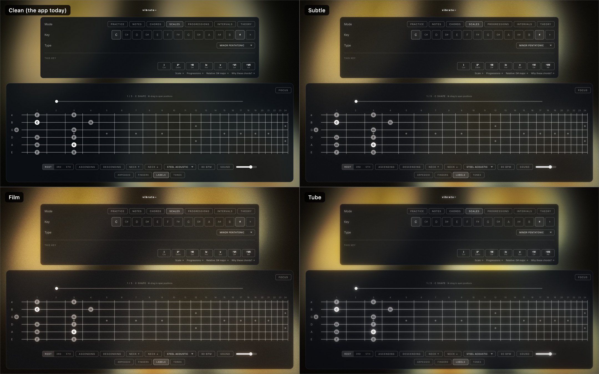
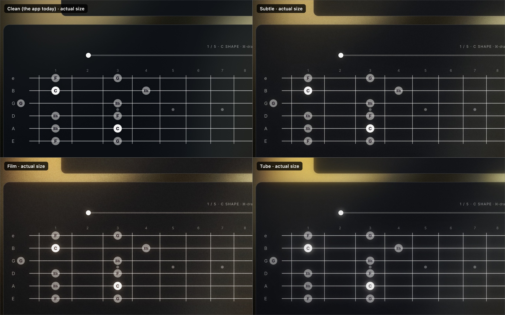
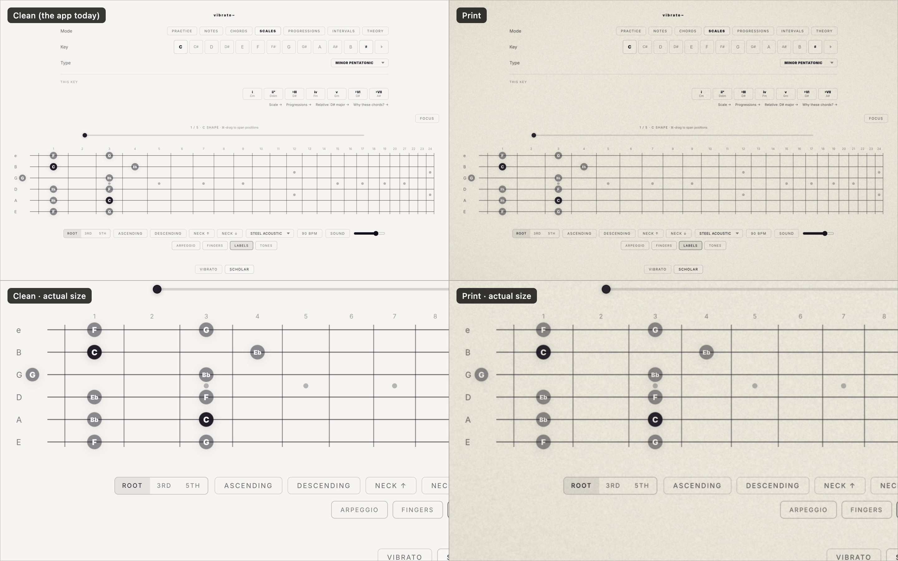

# vibrato~ roadmap

**Working branch:** `vibrato-next` (cut from `codex/practice-sessions` at `1a91f7c`)
**Last updated:** 2026-11-23

This file is the plan of record. It came out of a full review of the app on 2026-11-10 (teaching, layout, look) that the owner approved. It is written so that anyone, human or AI, can pick up a work package without having seen that conversation.

## Status

| # | Work package | Status | Depends on | Who should do it |
|---|---|---|---|---|
| A | Single-screen layout | Done. Owner walked through it on 2026-11-12; follow-ups are I to Q | nothing | the strongest model, or an experienced front-end developer: it needs design judgment |
| B | Teaching fixes (five small ones) | Done and reviewed, 2026-11-11 | nothing | any capable model: fully specified and test-backed |
| C | Chord shapes and small triads | Built 2026-11-14 on `claude/modes-m-c-dc462b` (Fable 5.2), not merged. A guitarist should still play through the fingerings Merged into `vibrato-next` 2026-11-14; the owner's review is open. | nothing | a strong model, and a guitarist should check the fingerings |
| D | Discover mode | Folded into M and P on 2026-11-12: no separate mode | – | – |
| E | Practice that adapts | Built 2026-11-14 on `claude/practice-e-63ba7d` (Fable 5.2), not merged: spec in `docs/specs/E-adaptive-practice.md`, with ten decisions for the owner to check. The jam loop moved to P Merged into `vibrato-next` 2026-11-14; the owner's review is open. | O | a capable model |
| F | Look: analog texture, and Vibrato's panels | Default look done and reviewed, 2026-11-11. Vibrato's panels became outlines on the lava, 2026-11-13, with a Fill slider since 2026-11-14. The owner approved the new colours, the panels and Fill as they are (2026-11-14). Open: measure the texture's cost on real hardware, once the parallel builds are done and the machine is quiet | nothing | any capable model: the values are decided |
| G | Later: hands-free, listening, tunings | Not started | A | to be decided |
| H | Theory figures: one key dial | Done, merged and pushed 2026-11-12. H2 (a vertical neck in the dial's place) merged 2026-11-14; the owner's last check (Dial and Neck feel elegant) is open. H's two open items can start | – | the strongest model designs; a capable model builds |
| I | Quick fixes from the 2026-11-12 walkthrough | Done, merged 2026-11-12 | nothing | a capable model |
| J | Split `App.tsx` into mode components | Done, merged 2026-11-12 (`App.tsx` 1,529 → 428 lines) | I | a capable model, carefully: no change in behaviour or look |
| K | Settings page in the side panel | Done, merged 2026-11-12 | J | a capable model |
| L | One Play control for every mode | Done, merged 2026-11-12 | J, K | a capable model |
| M | Mode controls: Notes, Chords, Scales | Built 2026-11-14 on `claude/modes-m-c-dc462b` (Fable 5.2), not merged. Waiting for the owner to approve the screenshots in `docs/design/modes-m/` Merged into `vibrato-next` 2026-11-14; the owner's review is open. | J, K, L | a capable model; the owner approves screenshots |
| N | Intervals: clear drills, black and white | Done, merged 2026-11-12 | nothing (K adds the colour switch later) | a capable model |
| O | Practice: show the plan before Start | Done, merged 2026-11-12 | nothing | a capable model |
| P | Progressions: the improvising workshop | P1 and P2 merged 2026-11-12, P2.1 (a real bass voice, chord lengths, measured levels) and P2.2 (mix faders, the form strip) 2026-11-13. P3's targets on the neck and P4 (one prompt per pass): spec written and built 2026-11-14 on `claude/progressions-p3-p4-1faf6f` (Fable 5.2), not merged; the owner's play-along and thirteen decisions are open. Not built: the neck showing every tone of the current chord, and the Whole neck, Region and One string lenses as a choice (proposed as P3.2) Merged into `vibrato-next` 2026-11-14; the owner's review is open. | J, L | the strongest model writes specs and reviews; a capable model builds |
| Q | Home screen and resizable panel | Built 2026-11-14 on Sonnet 5.5, on `claude/home-q-9e6d7e`: waiting for the owner's review Merged into `vibrato-next` 2026-11-14; the owner's review is open. | J, K (both edit the frame) | a capable model |
| R | Notes: the owner's comments and pen marks on the running app | Built 2026-11-21 on `vibrato-next`, not committed yet. The owner has not tried it in the installed app | nothing | the strongest model (it decides how feedback reaches whoever builds next) |
| S | Sound: instruments we model ourselves | S1 (research, a modelled bass, a sound lab) merged 2026-11-13 and is now the jam loop's default. S2 (drums: three kits, four grooves, fills, a Drums fader) merged 2026-11-13. The owner compared the kits on 2026-11-14: a great first pass, but no kit impressed yet. S2.1 (better kits): three candidates, D rock room, E neon and F garage, are in the sound lab beside A, B and C on `claude/drums-s21-3e68a6`, measured but not yet heard by anyone; the jam's default kit is unchanged until the owner picks. More bass presets and organ later | P2.1 | Fable 5.2, at the owner's request |

The owner's usage is limited, so the rule is: well-specified packages go to cheaper models, and the strongest model keeps the work that needs judgment (A, and reviewing what comes back).

## How to work on this

- Work on `vibrato-next`. Pushes to it run the **Build Vibrato** workflow (lint, tests, Mac package).
- One checkbox per commit where you can. Keep commits small enough to revert.
- In the same commit: tick the box here, and add a dated line to the [log](#log) if you decided anything.
- Before calling something done: `npm test`, `npm run lint`, and the [no-scroll check](#no-scroll-check) if you touched layout.
- Do not change the look (colours, type, shapes, spacing style) outside package F. The owner wants to see mock-ups first.

```sh
npm install
npm run dev        # http://localhost:5173
npm test
npm run lint
npm run app:build  # Mac app in release/
```

## What the app is for

In the owner's words: "getting comfortable on the guitar, practice, training and discovery", "partially just eye candy, and a visual reference for me", and "I like to noodle and improvise, so anything that can inspire me and get my creative juices flowing".

So the measure of any feature is whether it helps someone with a guitar in their hands. That person is looking at the screen from playing distance and cannot easily reach the mouse.

**The owner as a player (2026-11-12).** A returning intermediate: played most of their life, used to read and write notation, improvised a little, can learn intermediate solos, and has not played seriously for about ten years. Picking the guitar up now, they "default to just the major scales that I remember, the chord shapes, and there's no intent behind the playing". The goal: "solo over chord progressions and become a stronger improviser", move up and down the neck "and not get locked into the CAGED positioning", so that noodling becomes focused. Each mode should teach one subject that you then apply. Judge new features by whether they give intent while playing: which notes matter on this chord, a reason to move along the neck, a constraint to play inside.

## What is already strong (do not break it)

- **The interval-first path** in Intervals mode (Learn, Shapes, Find, Identify, Shells, Build, Changes), with one colour and shape per interval (`INTERVAL_COLORS`, shapes in `src/lib/music/chordTones.ts`). This colour and shape language is the app's teaching vocabulary. Reuse it everywhere; never invent a second one.
- **The "This key" panel** (`KeyContext`) and the lava background coloured by key (`src/lib/keyPalette.ts`).
- Sampled guitars, CAGED labels that are correct in every key, and key-aware note spelling on the fretboard.

---

## A. Single-screen layout

**Why.** The owner: "the current app has me scrolling the page more than I'd like". Measured in the browser at 1440×900, the size the Electron window opens at (`electron/main.cjs`):

| Mode | Page height | Overflow | What is below the fold |
|---|---|---|---|
| Notes | 900 | 0 | nothing |
| Scales | 1001–1025 | 101–125 | display toggles |
| Intervals | 983–1055 | 83–155 | bottom of the neck in some drills |
| Practice, landing | 1006 | 106 | the end of the page |
| Practice, running | 1247–1359 | 347–459 | ratings, metronome, sound; in the Changes block the lowest string |
| Chords | 1263 | 363 | every chord diagram |
| Progressions | 1378 | 478 | lowest string, Play, chord diagrams |
| Theory | 2166 | 1266 | the circle of fifths |

At 1280×720 every mode overflows by 280 px or more. At 1728×1080 the fretboard is the same size as at 1440×900.

**Causes.**

1. `SettingsList` (mode, key, mode controls, "This key", topics, About) is stacked above the fretboard. It is 285–447 px tall, and 850 px in Theory.
2. The fretboard has a fixed height: `FRETBOARD_LAYOUT.stringGap` is 36 in `src/lib/fretLayout.ts`, so the SVG is always 240 px tall (264 with region badges).
3. Reading text sits above the instrument. Opening "About" in Progressions pushes the neck down to 982 px.
4. Drill controls change height, so the neck moves up to 72 px when you switch Interval drills.

**Target.** One fixed frame that fills the window. The page itself never scrolls.

| Region | Holds | Rule |
|---|---|---|
| Top strip | wordmark, mode switch, key, tempo and transport, theme | one row, fixed height |
| Neck | the fretboard, position slider, focus | takes all remaining height; string gap grows with the window |
| Deck | the controls of the current mode (scale, chord, progression, drill tabs, sound, display toggles) | fixed height for every mode and drill, so the neck never moves |
| Side panel | "This key", chord diagrams, theory text, practice history | the only region that may scroll; can be closed |

Where today's pieces go:

| Piece | Component | Goes to |
|---|---|---|
| Mode switch | `StudyModeControls` | top strip |
| Key | `KeySelector` | top strip |
| Scale, chord, progression pickers and drill tabs | `StudyModeControls`, `IntervalTrainer` | deck |
| Sound and display toggles | `AudioControls`, `DisplayToggles` | deck |
| "This key" | `KeyContext` | side panel |
| Topics and About | `TheoryNavigator`, `TheoryPanel` | side panel |
| Chord diagrams, progression strip | `ChordPositionStrip`, `ProgressionStrip` | side panel, or deck if they fit in its height |
| Practice timer, block, transport, rating | `PracticeSession` | deck |
| Practice history | `PracticeSession` | side panel |
| Circle of fifths and other theory figures | `TheoryStage` | share the neck region, no page scroll |

Within those rules the details are the implementer's call. Keep the current visual style; this package moves things, it does not restyle them.

**Tasks.**

- [x] Make the shell a grid that fills `100dvh` with the four regions; `overflow: hidden` on the page. `src/components/Frame.tsx`.
- [x] Re-home each `SettingsList` section according to the table above. Two changes to the table, see [decisions](#decisions).
- [x] Make the fretboard scale with the space it is given (string gap roughly 36 to 56 px), keeping labels readable. 36 px at 960×640, 55 at 1440×900, 64 at 1728×1080.
- [x] Give the deck one height for all modes and drills. 232 px, 216 below 760 px tall.
- [x] Practice: everything needed during a block is visible at once (neck, timer, transport, rating).
- [x] Below about 1100 px wide or 680 px tall the side panel becomes a drawer over the neck, not a stacked block.
- [x] No text under 12 px in anything that gets moved. About two-thirds of the font sizes in the app are below that today (most common: `0.62rem`). Done for CSS text; SVG text inside diagrams is not, see [not done](#not-done-or-not-checked).
- [x] Give the three hidden gestures a visible control or a hint while re-homing them: Cmd-drag on the position slider, Cmd-click on Labels, and clicking Vibrato a second time to flip the canvas.
- [x] Give the Texture switch its own place. In the dock it sits beside Vibrato and Scholar in the same button style, so it reads as a third theme.

**Done when.**

- At 1440×900, 1280×720 and 960×640 (the Electron minimum), in all seven modes, every Interval drill and every Practice block, the page does not scroll.
- The top edge of the fretboard is at the same y in every mode and drill (within 1 px).
- The fretboard is taller at 1728×1080 than at 1440×900.
- Tests and lint pass.

### No-scroll check

Paste in the dev-tools console for each mode and window size. `page` must equal `window`.

```js
({ page: document.documentElement.scrollHeight, window: innerHeight,
   neckTop: Math.round(document.querySelector('.fretboardStage').getBoundingClientRect().top) })
```

Since the frame clips its regions, `page` now always equals `window`; what can still go wrong is a control cut off at a region's edge. `scripts/check-layout.cjs` checks both, for every mode, Interval drill and Practice state, in any window size and theme. With `npm run dev` running:

```sh
./node_modules/.bin/electron scripts/check-layout.cjs                      # four sizes, dark
./node_modules/.bin/electron scripts/check-layout.cjs --themes light,scholar --sizes 960x640 --shots all
```

Each line gives page and window height, the neck's top, the board's top, height and string gap, and the number of elements that spill out of their region (an open menu spills on purpose). Results and screenshots go to the system temp folder, `vibrato-layout-check`.

### What was built

Built on 2026-11-11. Every mode returns its parts as frame regions (`<Neck>`, `<Deck>`, `<SidePanel>` from `src/components/Frame.tsx`), and the frame's CSS grid places them, so the Interval trainer and Practice session keep their own state while their pieces sit in different regions.

| Region | Holds |
|---|---|
| Top strip (52 px; 48 below 760 px tall) | wordmark (at every width since 2026-11-23), **Practice**, the **Explore** menu (Notes, Chords, Scales, Progressions, Intervals) and **Theory** (seven mode tabs until 2026-11-23), **Key** (a menu with the twelve key tiles and the ♯/♭ switch; not in Notes or Practice), **Panel** (shows or hides the side panel; not in Notes), Notes (the pencil), Settings. **Theme** was a menu here until 2026-11-23 and is now the last section of Settings |
| Neck (everything left over) | a bar of fixed height (the position slider with **Span**, or the Interval prompt, or the Practice instruction) with **Focus** at its end; under it the board, the Theory diagram, the Identify answers, the ear-training card, or the Practice welcome and result |
| Deck (232 px; 216 below 760 px tall) | the mode's own controls: Type and System, Progression and Chord, the note tiles in Notes, the drill tabs and options, the Theory diagram choice and links; then transport (start note, play buttons, tempo); then sound and view (guitar, mute, volume, Arpeggio, Fingers, Labels, **Solid**, Tones). In a Practice block: title, chord strip, timer, transport, Finish early, rating |
| Side panel (22% of the width, 280–340 px; the only part that scrolls) | This key; chord positions (Chords); chords and About (Progressions); Topics and About (Theory); This session, Options and Sound (during a Practice block); Your recent practice (Practice start and end). Notes has none, so its neck is wider. Docked beside the neck from 1100×680 up, open by default and remembered. Below that it is a drawer over the neck: Panel opens it; Close, Esc or a click outside closes it |

#### Decisions

- **Tempo and transport went to the deck, not the top strip.** The seven mode buttons plus Key, Theme and Panel already fill the strip at 960 px, and what Play means changes with the mode.
- **The key is a menu in the strip**, holding the same tiles as before. Notes keeps its tiles in the deck, because choosing notes is that mode's main control.
- **The neck grows with the window, not only with its height.** The board fills the neck's height, with the string gap capped at window width ÷ 26: 36 px at 960, 55 at 1440, 64 at 1728. That is a little over "roughly 56" at 1728, so a larger window always gets a larger neck. Dots and letters grow at 60% of the gap's rate (`boardScale`, `labelScale` in `src/lib/fretLayout.ts`, tested).
- **The strings themselves stay put, not only the neck's edge.** The neck bar has one height in every mode, and a filling board always reserves the CAGED letter row, so the top string is at the same height in every mode and drill.
- **Focus** now hides the top strip and the side panel; neck and deck stay, so Play is still at hand. Esc leaves it.
- **Build drill:** its fourteen targets are a select now. As buttons they wrapped to two rows and did not fit the deck.
- **Practice:** the instruction sits in the bar above the board. During a block the session overview (blocks, progress), the metronome and ramp options and the practice sound settings are in the side panel.
- **Hidden gestures:** a Span button beside the position slider (Cmd-drag still works); a Solid button beside Labels (Cmd-click on Labels still works); a Canvas row (Dark, Light) in the Theme menu, so picking Vibrato again no longer flips the canvas. Texture has its own On/Off row with "Hold B to compare".
- **12 px:** 54 font sizes under `0.75rem` in the moved components were raised to `0.75rem`, and so were pills, selects and key tiles (`glass.module.css`). Fret numbers are 12 px and grow with the board.

#### Measured

`scripts/check-layout.cjs`, 2026-11-11, every mode, every Interval drill (and Identify with all twelve intervals), Practice start, all four blocks, review and finished, Theory with circle, wheel, text-only topic and fretboard. Vibrato dark, Vibrato light and Scholar.

| Window | Page height | Neck top, every mode and drill | Top string, every mode | String gap | Board height | Controls cut off |
|---|---|---|---|---|---|---|
| 960×640 | 640, all 29 states | 64 | 121.6 | 36.9 px | 271 px | none |
| 1280×720 | 720, all 29 states | 64 | 116.5 | 49.2 px | 361 px | none |
| 1440×900 | 900, all 29 states | 74 | 179.9 | 55.4 px | 406 px | none |
| 1728×1080 | 1080, all 29 states | 74 | 238.3 | 64 px | 469 px | none |

The same numbers in all three themes (348 runs). Before this package, at 1440×900 the page was 900 to 2451 px tall and the neck's top moved between 175 and 1262 px depending on the mode; the board was 240 px tall at every window size. Focus moves the neck to the top of the window on purpose; the open Key and Theme menus hang below the strip on purpose.

#### Not done, or not checked

- **SVG text inside diagrams is still under 12 px:** the dot letters in chord diagrams (side panel), the circle of fifths and chord wheel labels, and on the main board the letters inside small dots (10 px at 960×640, growing with the board) and fret numbers 20–24 on a narrow board (10–11 px, so neighbours do not touch).
- **Practice was measured paused,** not with sound running. The running state has the same layout.
- **Checked in Electron's Chromium only,** not Safari or Firefox, and not below 960 px wide.
- **The owner has not seen it yet.** Things to ask: is the side panel worth its width by default, is the Key menu quick enough, and is the neck's size right at 1440×900.

---

## B. Teaching fixes

Five places where the picture contradicts the lesson. Each is small and independent.

- [x] **Changes drill shows guide tones that jump around.** `changesPositions` in `src/components/IntervalTrainer.tsx` picks each chord's 3rd and 7th relative to that chord's own root. In C, for ii–V–I, it shows Dm7 as F (high-e string, fret 13) and C (B string, 13), then G7 as B (high-e, 7) and F (B, 6), then Cmaj7 as E and B both on the high-e string, while the caption says "Common tone held". The lesson of this drill is the opposite: the guide tones barely move.
  **Fix:** choose positions by the smallest movement from the previous chord, on one pair of adjacent strings.
  **Done when:** in C the drill shows Dm7 as D string 10 (C) and G string 10 (F); G7 as D string 9 (B) and G string 10 (F); Cmaj7 as D string 9 (B) and G string 9 (E). A test asserts no voice moves more than 2 frets between chords, and that "held" is only said when string and fret are unchanged.
- [x] **Key panel spells flats as sharps.** `src/components/KeyContext.tsx` uses `formatNoteDisplay(note, notation)`, a global sharp/flat switch. In C minor it shows "♭III D#", "♭VI G#", "♭VII A#" and "Relative: D# major", while the fretboard correctly shows E♭.
  **Fix:** use the key-aware spelling in `src/lib/music/noteSpelling.ts`.
  **Done when:** C minor shows E♭, A♭, B♭ and "Relative: E♭ major"; a test covers one sharp key and one flat key.
- [x] **Shapes drill lists shapes nobody can play.** `getIntervalDyadShapes` in `src/lib/music/intervalShapes.ts` has no reach limit and offers, for example, "String skip −6 frets" for a major 3rd.
  **Fix:** drop shapes that span more than 4 frets.
- [x] **The active CAGED letter under the neck is invisible.** `.regionBadgeActive` in `src/components/Fretboard.module.css` uses `fill: var(--note-label-fill)`, which is dark on the dark theme and near-white on the light ones.
  **Fix:** use the theme's main text colour. Contrast at least 4.5:1 in Vibrato dark, Vibrato light and Scholar.
- [x] **Hover looks more "on" than selected.** In `src/styles/glass.module.css`, `.pill:hover` uses `--glass-bg-hover` (0.14 alpha) and `.pillSelected` uses `--glass-bg` (0.06).
  **Fix:** selected is always the strongest state.

Follow-ups from the owner's review, where the original rules were musically wrong:

- [x] **Keys on black notes were spelled badly.** With sharps preferred, B♭ major read A#, B#, C##, D#, E#, F##, G##. With flats preferred, C# minor read D♭ minor with F♭ and B♭♭. A black-key root now takes whichever name needs fewer accidentals, which is the circle of fifths' choice. The sharps/flats switch only breaks the F#/G♭ major and D#/E♭ minor ties. This covers the fretboard, the key panel, chord names and the title. Progression chords are spelled by their key.
- [x] **The reach limit hid same-string shapes.** Two notes on one string are always played one after the other, and "a 5th is seven frets up the string" is the lesson. The 4-fret limit now applies only to shapes across strings, where the hand has to hold both notes.
- [x] **"Guide tones barely move" is only true when the root moves by a 4th or 5th.** In I–vi the root falls a third, so one guide tone has to leap (Cmaj7 to Am7: E to G). The caption used to name only the smooth voice. It now says "Root falls a third: 7 → ♭3 rises a half step, 3 → ♭7 leaps up a minor third", so the exception teaches something.

---

## C. Chord shapes and small triads

**Why.** Chords mode only knows the E-shape and A-shape barre chords plus open chords, repeated an octave up (`CHORD_SHAPES` in `src/lib/music/positions.ts`; the loop adds 12 to the base fret). C major's five "positions" are open, 3, 8, 15 and 20. Theory mode teaches all five CAGED shapes, so the two modes disagree.

- [x] Add the C, G and D shapes for the main qualities.
  **Done when:** C major shows five positions inside frets 0–13: C shape (open), A shape (3), G shape (5), E shape (8), D shape (10), each labelled with its letter.
  **Built 2026-11-14.** Major, minor, dom7, maj7 and min7 have all five letters in every key, in the forms that are played:
  - C shape: five strings for major and maj7 (D is x-5-4-2-3-2), four for minor and dom7 (Dm x-5-3-2-3-x, D7 x-5-4-5-3-x), the top four for min7 (Dm7 x-x-3-5-3-5).
  - G shape: the top four strings for major, dom7 and maj7 (C is x-x-5-5-5-8), the low four for minor (Am 5-3-2-2-x-x). There is no G-shape min7: no form of it can be fingered, so min7 has four shapes.
  - D shape: the open D chord moved up on the top four strings.
  - Open chords carry their letter ("Open C shape") and replace that shape at the nut. Open C minor (x-3-1-0-1-x) and G minor (3-1-0-0-3-3) were added for the same reason.
  - `buildChordPositions` takes a shape set. Chords mode asks for `caged`. Progressions keeps `barre` (E and A shapes and the open chords): its climb is specified on those regions ([specs/P3-climb.md](specs/P3-climb.md)), so moving it to all five is P's decision.
  - A fingering checker (`fingeringFaults.ts`) runs over every shape in all 12 keys: four frets at most, fingers in order, real barres. It found three old shapes nobody could hold: maj13 and min13 (five fingers, or a five-fret reach) are now the usual root, 7th, 3rd, 13th forms from the low E string, and open Gmaj7 is refingered.
- [x] Add triads on three adjacent strings: four string sets, three inversions, for major, minor, diminished and augmented. These are what an improviser actually uses.
  **Built 2026-11-14** (`src/lib/music/triads.ts`, tested in all 12 keys). In the Chords deck, Voicing switches between Shapes and Triads, and Strings picks G B e, D G B, A D G or E A D. The position bar and the side panel name each one by its inversion. A seventh or extended chord has no small triad, so Triads is greyed out there and says why. One shape is wider than four frets: the root-position diminished triad on the two lower string sets (B° on E A D is 7-5-3), fingered 1-2-4 like two whole steps on one string.

---

## D. Discover mode

**Folded in on 2026-11-12, no separate mode.** The moves become the Progressions library (P1), the sounds become a drone in Scales (M), and the lenses and sparks become prompts (P3, P4). The text below is kept as the source for that work.

**Why.** The owner asked for "a 'discovery' section where I can hear weird chord progressions, unique scales, different ways to think about notes". The gap today: the app shows where notes are but never puts harmony under them, and a mode only sounds like itself against a chord.

**The one new ingredient is a sustained sound.** `GuitarAudioEngine` (`src/lib/audio/engine.ts`) plays samples and patterns (`playPattern`) but has no drone. Add a pad voice with Tone (slow attack, chorus, low-pass) into the existing reverb and limiter.

Four parts:

| Part | What the player does | What the app does |
|---|---|---|
| **Sounds** | picks an unusual scale | shows it on the neck with interval labels, holds a drone under it, says which note to listen for |
| **Moves** | picks a chord progression | loops it with the pad, lights up the current chord's tones in one position, says what to play over it |
| **Lenses** | picks a way of thinking | for example a brightness dial from Lydian down to Locrian, one flattened note per step |
| **Spark** | asks for a prompt | deals one constraint, such as "Leave two full beats of silence after every phrase." |

**Content is written.** [discover-starter-content.json](discover-starter-content.json) has 12 sounds, 12 moves, 6 lenses and 18 sparks. All numbers are semitones above the key root.

- `sounds[]`: `name`, `tag` (short label), `f` (formula as degree names), `iv` (intervals), `pad` (drone chord), `vibe`, `ear` (what to listen for), `over` (where it fits), `heard` (a recording that uses it).
- `moves[]`: `name` (Roman numerals), `tag`, `ch[]` (each chord: `n` numeral, `o` root offset, `q` quality; map `q` to `ChordQuality` in `src/lib/music/chords.ts`), `vibe`, `why` (why it works), `over` (what to play), `heard`.
- `lenses[]`: `name`, `blurb`, `prompt`, and either `variants[]` (each with `label`, `iv`, `pad`, `note`, optional `lb` label overrides) or `deal: true` (the app deals random notes).
- `sparks[]`: plain sentences.

**Already in the code:** the Build drill draws any interval set (`getPositionsForIntervals`), and `playPattern` loops with count-in and metronome.

- [ ] Pad voice in the audio engine, with drone on/off and its own volume. It stops when you leave the mode.
- [ ] Move the content into typed data under `src/lib/music/` with a test (formula agrees with intervals; numeral agrees with offset).
- [ ] Sounds: neck + drone + "play the scale" + the four lines of text.
- [ ] Moves: loop at the global tempo, one bar per chord; current chord's tones highlighted without the position window jumping.
- [ ] Lenses, starting with the brightness dial (highlight the one note that changed).
- [ ] Spark.
- [ ] Left/right arrows step through entries; Space plays and stops.

**Done when:** it fits the single-screen frame, sound starts with one click, and every entry plays in all twelve keys with correct spelling.

---

## E. Practice that adapts, and a jam loop

**2026-11-12:** the jam loop moved to Progressions (P2). Adaptive practice stays here and follows O. Also widen the Ear block beyond ♭3, 5 and ♭7: they are all consonant and easy to tell apart, so the major 3rd and the tritone should join over time.

**Today.** The session is the same four blocks every day (Roots 2 min, Scale 3, Ear 2, Changes 3), always minor, always the lowest pentatonic box, always the same three ear intervals and i–iv–V. Ratings are saved and never used. See `src/components/PracticeSession.tsx` and `src/lib/practice/`.

- [x] Rotate the scale box (1 to 5) and the ear intervals from day to day. One box a day for Roots, Scale and Changes; three ear intervals a day from a ladder that grows (♭3, 5, ♭7, then 3, ♭5, 4, 6, 2, 7).
- [x] Use the ratings: a block marked hard comes back tomorrow, one marked easy moves on. For the Ear block the score decides and the rating can only hold it back.
- [x] Changes block: keep one position window for all three chords.
- [x] Vary the key and quality: five boxes in one key make a lap; then the relative major, then up a fourth.
- [x] The plan explains today's choices in one line, and the finished screen says what comes next.
- ~~Jam loop: any progression, any tempo, chord tones highlighted in one position.~~ Obsolete here: P2 built it in Progressions.

**Built 2026-11-14** on `claude/practice-e-63ba7d`. The rules, the evidence behind them and the decisions to check are in `docs/specs/E-adaptive-practice.md`.

Research on musicians is small but points toward mixing material within a session over repeating one block (Carter and Grahn, 2016). The spec's evidence note covers interleaving, spacing, difficulty and why a rating alone should not promote anything.

**From the owner's first notes, 2026-11-21** (left in the app with package R; all four in `PracticeSession.tsx` and `src/lib/practice/`).

- [x] **Leave a block early.** "Skip to Scale" beside Finish early, in blocks 1 to 3. The side panel marks a skipped block with a dash.
- [x] **Chord lengths in the last block.** Click a chord in the strip: 1, 2, 4 bars and round again, each chord its own, remembered (`vibrato:practice-changes-bars`). The owner asked for single beats (4, 5, 6, 7); bars were built instead because the count-in, the click and the beat dots are in 4/4, and a 5-beat chord moves the change off the count. A long chord is struck again every bar. Changing a length while playing is taken up where the loop is, with no stop and no count-in (`swapPattern` in the engine, `barsBeat` in `pattern.ts`); a change to the chord that is sounding lands at the next bar line.
- [x] **Say who plays what.** The last block was "Make it musical" and the owner could not tell whether to copy the chords or improvise. It is now "Solo over the chords", and its instruction opens "The app plays the chords. You improvise over them".
- [x] **The end of a block and of the session.** After any block: Next, or "Play this block again" (extra time, shown as `+0:42`, never logged). After the last: Finish session, Play this block again, or Discard, which leaves with nothing logged so a trial run does not move the plan on. Discard is also in the Finish early question. The Space hint and Finish early are hidden where they do nothing.

**Block lengths and the ear round, 2026-11-21** (the owner, after the first pass: block lengths should be "variable depending on what it is"; the ear block "shouldn't be a timed thing", its running tally "just fills the time up", and "why just those three" intervals).

- [x] **Each block's length is the player's.** On the plan, a card's "2 MIN" is a button: 1, 2, 3, 5 minutes and round again, remembered (`vibrato:practice-block-seconds`). While a block plays, "+1 min" adds a minute to it. A session saves its lengths (`seconds`), and is full when every block ran the length it was given; the added minute never raises that bar.
- [x] **Ear is a round of ten questions**, not two minutes (`earGoal`). The deck shows "4 / 10" where the clock was. Each answer is still marked right or wrong at once, but the tally waits for the end ("Round complete: 8 of 10"). Ten because 9 in 10 brings in an interval and fewer than six answers do not count.
- [x] **The round asks every unlocked interval**, the day's three twice as often (`earWeights`, `drawEar`), with one row of answers (short names only past five). Before, a day only ever asked its three.
- [x] **Start further up the ladder.** "Ear intervals" on the plan: the plan's own count, or 5, 7 or all 9 (`vibrato:practice-ear-start`, `planFor`'s fourth argument). It only raises the stage; a session saves the stage it was played at, so the ladder carries on from there.
- [x] **"Play this block again" logs its time** now (up to 15 minutes a block), since a session with its own lengths may run past them. Sessions saved before this keep the old limits.

This settles the question of a skipped block: with lengths of one's own there is less reason to skip. A skipped block still makes a short session, which does not move the box on.

**For the owner to check.** The defaults are unchanged (2, 3, 3 minutes, and ten questions). The headline counts the round as about a minute ("Nine minutes in A minor"). ♭2 and ♭6 are still not on the ear ladder. The spec's section 5 has the details.

**From the owner's spoken walkthrough, 2026-11-21** (a recorded pass through one session, read from its transcript).

Built:

- [x] **The plan's headline is "Daily practice in A minor"**, and the key in it is the key menu (dotted underline). The line of minutes and questions above it is gone, and so is the Key menu in the deck.
- [x] **Blocks are called what they are:** Root and fifth, Scale practice, Interval training, Solo over the chords (short names Roots, Scale, Intervals, Solo). The first card says "Find the root (A) and its fifth (E) between frets 5 and 8". The owner named three of the four; "Root and fifth" is mine, for "Find your bearings".
- [x] **Less on the plan and the summary:** guitar, volume, room and mute are in Settings and in the session's side panel only.
- [x] **The deck's controls are all buttons**, in two groups: Pause and Skip (or Next and Play again) on the left, "+1 min" and "End session" on the right. The underlined text links are gone.
- [x] **End session goes straight to the summary.** No question first. The summary has "Keep practicing" (opens the session again where it stopped; `reopen` in the reducer) and "Discard this session" (takes it out of the log). The rule between the summary and its buttons is gone.
- [x] **The app plays the notes once** (owner, 2026-11-21): Options has "App plays the notes": Once (the default), Every loop or Never, for Roots and Scale. Once: one time round with the notes, then the count, the click, the clock and the tempo ramp go on without them, and the main button becomes "▶ Hear it again" (a count-in, the notes once more; the loop count carries on) with Pause beside it. Saved as `vibrato:practice-guide`. Interval training is unchanged.
- [x] **What the dots say:** Intervals, Notes or Fingers, under the board (`boxFingers` in `board.ts` gives the usual box fingering; a guitarist should check boxes 2 to 5).
- [x] **Scroll through the keys** (owner, 2026-11-21): over the key in the plan's headline, a wheel click or a two-finger swipe (either axis) steps through the keys in the menu's order (`stepKey` in `plan.ts`); a click still opens the menu. One step per fresh movement, then one every 150 ms while the swipe has push (`KEY_STEP_*` in `PracticeSession.tsx`). Tuned on simulated events only: the owner should say how it feels. The focus box round the key is gone; keyboard focus turns the dotted underline solid.
- [x] **One key for the whole app** (owner, 2026-11-21, after a discussion of where the key is set): Practice plays in the app's key (note and major/minor) and changing the key in Practice changes it everywhere (`onKeyChange`). The plan's key is a suggestion: off it, the plan's line ends "Use the plan's key, A minor", and the key menu keeps "Today's plan". A session under way follows a key change (`rekey` in the reducer) and plays the notes once more in the new key; a finished one keeps the key it was logged in. The Key button in the top strip shows in Practice and on Home (Home's reads "A minor"). Leaving Scales or Progressions carries their major/minor to the next mode (`useStudyModeSwitch`); coming into them changes nothing, so G major in Practice, a look at Scales on a minor pentatonic, and back gives G minor. This replaces the practice-only background key and the "picked for today" key of earlier the same day.
- [x] **The Notes background moves through the selected notes** (owner, 2026-11-21): with two or more notes selected it rests about five seconds on each note's colour, in the order of the tiles (`getBackgroundKeyForMode`'s `turn`, `NOTES_COLOUR_MS` in `useAppTheme.ts`). Not under "reduce motion". Every recolour of the lava now turns by hue (`blendHue` in `keyPalette.ts`) instead of mixing the channels, so green to red goes by yellow, not brown.
- [x] **The strip's wordmark stays on Home** (owner, 2026-11-21): it was hidden there because Home has the large one. It is drawn again; on Home it does nothing, is out of the tab order and is not announced.
- [x] **The side panel as a drawer is frosted glass** (owner, 2026-11-21: "it's just dark"): in a narrow window the panel floats over the neck; it was a 97% dark sheet and is now a 15% tint (the owner's figure) over a 36 px blur of what is behind it, with the lava's text halo kept (`Frame.module.css`). Checked on the dark canvas in a yellow key, the brightest; the light canvas (72% paper tint) is not checked. Scholar keeps its solid paper. It slides in from the right edge (320 ms, most of the way in the first 100 ms, then settling) and out in 170 ms, where it used to fade (`drawerIn`, `drawerOut`); not under "reduce motion".
- [x] **The menus are frosted glass too** (owner, 2026-11-21): Key, Theme and the Play options open from `Popover`, whose panel was a 96% dark sheet; it now has the drawer's 15% tint over a 36 px blur (`Popover.module.css`). On the light canvas and Scholar it stays a solid sheet.
- [x] **A shorter Theme menu** (owner, 2026-11-21): Style, and for Vibrato Panels and Fill. Canvas is gone (Vibrato is always dark; Scholar is the light look; a saved Light is ignored and the light-canvas styles are left unused in the stylesheets), Texture is gone (always on; a saved Off is ignored; hold B still compares), Lava is gone (always Flow). Panels was checked and is wired: Outline draws the hairlines round the strip, the main area and the side column, Off removes them; on Practice the many lines inside the page are Practice's own, which is why the owner saw no change.
- [x] **Scholar, a pass** (owner, 2026-11-21): Practice in Scholar used the old light canvas's green-black (a dark green Start button, green-grey type); it now uses Scholar's ink. The paper texture was one 300 px tile and read as large blotches; it is now a 200 px sheet under a fine 104 px tooth (`AnalogLab.css`). The correct answer in the ear round is marked in ink, not green, and the beat dot has no glow. The three rating buttons stay three across in a narrow side panel. Looked at in Scholar and found clean: Home, Notes, Chords, Scales, Progressions, Intervals, Theory, a Practice block, the ear card and the summary.
- [x] **Layout check after the day's changes** (2026-11-21): `scripts/check-layout.cjs --themes dark,scholar`, 440 states over four window sizes. No page scrolls and nothing is cut off outside an open menu, Practice included at 960 by 640 with the Key button now in its strip. One flag turned out to be the check's own: with Theory's neck shown, the hidden dial layer (turned 10 degrees) reaches 4 px below a 1728 by 1080 window. Nothing drawn is cut off, so the check's window pass now skips hidden elements, as its region pass already did.
- [x] **Scholar, second pass** (owner, 2026-11-21: "animated grain ... slightly smaller ... a little too contrasty"): the fine grain now moves, about 12 steps a second (Print's motion is 25; `AnalogLab.tsx` moves only `.analog-grain-floor` on paper, and the sheet under it holds still). The sheet is smaller and fainter (150 px, 0.06 of grain) and the fine grain smaller and softer (92 px, 0.12). The wordmark's wave moves in Scholar too: it had held still there by an earlier rule, which the owner took for a fault. Reduced motion stops both. Package F's "paper does not move" no longer holds.
- **Parallel work, checked 2026-11-21:** every `claude/*` branch and worktree is merged into `vibrato-next` and none has uncommitted changes; nothing on the remote is unmerged. One other session ("Module comments and annotations", the in-app notes) works in this same folder, not a worktree; its changes were in the tree and went into commit f2630ea.
- [x] **The built app had no blur at all** (owner, 2026-11-21, a screenshot of the Theme menu with the side panel showing sharp through it): the minifier folded each `backdrop-filter` / `-webkit-backdrop-filter` pair into the prefixed property alone, which Electron's Chromium ignores. The dev server does not minify, so every check of the frosted drawer and menus there passed. The prefixed declarations are gone from the source, the CSS is built for Chromium (`build.cssTarget` in `vite.config.ts`), and `npm run build` now ends with `scripts/check-build-css.cjs`, which fails if the blur is lost again. Checked in a hidden window on the built `dist`: the Theme menu over a 38% filled, docked side panel is frosted. Lesson: check look changes in the built app, not only the dev server.
- [x] **Interval training is flashcards** (owner, 2026-11-21): no count-in, no tempo line and no beat dots in that block.
- [x] **The rating is in the side panel** (owner, 2026-11-21): "How does it feel?" and its three buttons moved from the deck to the foot of "This session", to clear the deck. With the panel closed the rating is out of sight.
- [x] **Interval training moves on by itself** a beat after each answer (1.1 s when right, 2.2 s when wrong). The Next button is gone.
- [x] **A round is dealt, not drawn** (`earRound`): every unlocked interval at least once, shares by weight. The owner had nine questions with no perfect fifth. And the ladder starts at five intervals unless changed (`vibrato:practice-ear-level`).

Open, to talk through with the owner:

- [ ] **The plan's line** ("Box 1 opens a lap of the five boxes in A minor. Ear: …") means nothing to the owner, who also does not use the word "box". It also names the plan's key when another key is picked. Needs new wording, and a word for box (position?).
- [ ] **Theory inside a block:** the owner wants the why of what is being practised (root and fifth, and so on) on the screen while playing, not only a line on the plan.
- [ ] **Moving on by itself after a block.** The owner looked right for Next and found it left; Next now sits beside Play again. Whether a finished block should go on without a click is undecided: the rest is where the rating and the ear score are.
- [ ] **The chord strip in Solo:** the owner expected a click to pick a chord (and start from it) and a second click to change its length. One tile does one thing now.
- [ ] **Hear the scale once, then play alone:** the switch is on or off for now.

---

## F. Look: analog texture

**Chosen by the owner on 2026-11-11: Subtle on Vibrato, Print on Scholar.** Any change to the look beyond those two treatments still needs the owner's sign-off.

**Direction, in the owner's words (2026-11-11):** "there's a minimalist futurism that I'm really into"; the Scholar theme (dark grey on off-white) is the reference. The 80s feeling should come from the medium, not from 80s objects: "televisions, tube amps and the way that screens looked", "film grain", "additional layers of noise that helps diffuse the cleanliness". And: "I don't want to fight the technology we have now", so "a filter of some kind ... to give it an analog look while keeping the minimalism".

**Working rules.**

- Keep the minimal language: thin type, hairlines, lots of space.
- Texture goes on the light, not on the information. Note labels and fret numbers stay sharp.
- Each theme gets the medium it honestly resembles. Vibrato is emitted light (glass, phosphor, film): glow that bleeds, grain that moves. Scholar is ink on paper: fixed paper tooth, slight ink spread, warm stock.
- It should be something you miss when it is switched off, not something you notice when it is on. No cartoon scanlines, no screen curvature, no VHS glitches.
- In the end the user gets one control for the amount. Honour reduced motion.

**Rejected, do not revive:** a "studio rack" concept with chamfered panels, LEDs, dot-matrix readouts and extended-sans legends. The owner's verdict: "generic 80s".

- [x] Mock-ups for the owner: the analog lab and the three images below.
- [x] Owner picks a treatment for each theme. Decided after trying the lab in the installed app: "Subtle is really nice", "print looks great on Scholar".
- [x] Make that the default look: on for everyone, chosen by theme, with one Texture on/off setting in the theme dock. Keep the lab panel as a hidden tuning tool.
- [ ] Measure what it costs on real hardware (see limits below).

**The chosen values** (0 to 100, as in `PRESETS` in `src/lab/AnalogLab.tsx`):

| Theme | Preset | grain | glow | fade | warmth | vignette | raster | motion |
|---|---|---|---|---|---|---|---|---|
| Vibrato, dark and light canvas | Subtle | 26 | 30 | 8 | 30 | 20 | 0 | 50 |
| Scholar | Print | 60 | 36 | 10 | 50 | 14 | 0 | 0 |

**Parked at the owner's request** ("make a note of it in case I want to bring it up again"): a blend of Subtle and Tube. Subtle as the base, a little of Tube's raster and falloff, and Glow kept low, because Tube's glow washes out the note letters ("lower the glow a little bit for some legibility"). Also "a subtle softness from a tube": a slight overall softening, which the lab has no dial for yet.

### The default look and the Texture setting

The texture is on by default, for new and existing users. The layer picks its levels from the theme (the table above) and follows theme changes.

- **Texture setting:** a "Texture" button in the theme dock. Off removes every layer and the root filter. Saved under `vibrato:texture`; state saved by the old prototype (`vibrato:analog-lab`) is ignored.
- **Hold B** to see the app without the treatment.
- **Hidden tuning panel:** the backquote key (`` ` ``) opens it. Its presets (Subtle, Film, Tube, Print) and seven dials override the theme's levels until the first preset, "theme", is picked. The dials change meaning with the theme: Glow becomes Ink spread on Scholar, Grain becomes Paper tooth. **Copy** gives the current settings as one line of text.
- **Code:** `src/lab/AnalogLab.tsx` and `.css` (the layer and panel, mounted in `src/main.tsx`), `src/lab/analogLevels.ts` (levels and saved-state parsing, tested), `src/lab/analogStore.ts` (shared saved state), and the button in `src/components/UiThemeSelector.tsx`.

The images below were made with the original prototype (clean, Subtle, Film, Tube).

Vibrato, whole window: clean, Subtle, Film, Tube.



The same four at actual size (view at 50% on a Retina display).



Scholar: clean and Print.



**How it is built.**

| Layer | Vibrato dark: emitted light | Scholar and Vibrato light: ink on paper | Mechanism |
|---|---|---|---|
| Glow | bright things bleed warm light across panel edges | ink spreads a little into the paper | one SVG filter on the root element |
| Grain | moves, 8 to 24 steps a second | fixed paper tooth | one 256 px noise tile blended over the window |
| Black lift, warmth, falloff | milky blacks, warm highlights, darker corners | faded ink, cream stock, toned edges | full-window layers with blend modes |
| Raster | faint scanlines and colour stripes | halftone dots | repeating gradients |

### Vibrato's panels: outlines on the lava (2026-11-13)

**Chosen by the owner on 2026-11-13: Outline.** The owner asked for "a version of vibrato style where there aren't any windows obscuring the lava flow ... just elements against the background", then for "outlines for the panels ... or perhaps just horizontal dividing lines". After comparing all four in the installed app: "I think outline is the move. looks great".

The filled panels (86% dark, 92% light) hid nearly all of the lava. Vibrato now draws each region (top strip, neck and deck, side panel) as a hairline outline with no fill. The drawer and the menus keep their solid surfaces, because they open over the neck.

- **Panels setting:** Theme → Panels, shown only on Vibrato: **Outline (default)** or Off (no edges, no fill). Saved under `guitar-practice-vibrato-panels-choice`, and only when the user picks one, so a later change of default still reaches everyone who never chose.
- **Fill** (2026-11-14). The owner: "remove 'on' and 'lines', but add an opacity slider so that 'outline' can effectively become 'on' if we raise the opacity up enough". Theme → Fill, 0–100%, default 0, used under Outline only (dimmed under Off). The panel surface is the old one at that strength, so 100% is exactly the old On: the same 86%/92% surface and the same faint edge. Saved under `guitar-practice-vibrato-panel-fill` on choice. A saved On becomes Outline at 100%, and a saved Lines becomes Outline.
- **Legibility on the lava:** the lava is dimmed 30% (lightened 30% on the light canvas), light type gets a soft halo of the canvas colour (`--lava-halo`), and frets, strings, pill borders and secondary text step up in strength. The edges use `--lava-rule`. Practice's muted grey is lifted too, and the pale Start button keeps no halo. As the fill rises, the extra dimming and the halo fade out and `--lava-rule` moves to the filled panels' own edge, so a full panel neither smudges its type nor darkens the lava twice. The stronger type and neck lines stay at every fill. On a full panel that is the one difference from the old On, and it reads fine.
- **Code:** one value, `--panel-fill` (0–1), set on `.themeRoot` in `App.tsx` (0 under Off). Tokens in `src/styles/tokens.css`. The region rules in `src/components/Frame.module.css`: `data-on-lava` now marks every Vibrato view, and `data-vibrato-panels` names the choice. The dimming in `AmbientBackground.module.css`. State in `src/hooks/useUiTheme.ts`. The rows in `UiThemeSelector.tsx`. While the slider is dragged, an `html:has(input[data-panel-fill]:active)` rule turns off the 900 ms fade, so the panels follow the thumb.
- **Checked:** screenshots at 1440×900 of Scales, Chords and Practice, dark and light canvas, in a hidden window. The worst case was small grey text over a bright yellow pool, which the halo and the lifted greys fixed. Fill checked at 0, 50 and 100% on both canvases, with the computed colours at 100% matching the old On exactly. Not checked: every key's palette, the 960×640 window, or how dragging the slider feels by hand.

### The lava's colours per key (2026-11-14)

The owner, on A major: "can we make the reds more vibrant? I don't love this gradient from red to white". They also asked how each key gets its colours.

**How a key gets its colours.** Each of the 12 notes has one colour (`NOTE_COLORS` in `src/lib/colors.ts`; A is red, A♯ crimson). The key's root picks it, and `getKeyBackgroundStyle` in `src/lib/keyPalette.ts` makes three lava colours from it:
- blob 1: the root colour, 18% more saturated;
- blob 2: turned 24° round the wheel (one way in major, the other in minor), and a little lighter;
- blob 3: see below.

The shader in `AmbientBackground.tsx` mixes them into six moving pools, with a pale band where pools meet (`bloom`).

**What was wrong.** Blob 3 was a pale, greyed colour from nearly across the wheel (+140° in major, +125° in minor). Mixed with the other two, it went to beige or grey in about half the keys: red with mint gave khaki, which read as "red to white". It also pulled every key off its own colour. On top of that, the 30% black veil added for the panel-less look (2026-11-13) turned the reds brick.

**The change.**
- **Blob 3:** turned 30° the other side of the root from blob 2, 6% lighter and 10% more saturated, so the pools centre on the key's colour.
- **Edges:** the colour where pools meet now ranges from about 0.12 to 0.22 in OKLCh chroma, against 0.04 to 0.14 before. Each key's average colour drifts about half as far from its note as before.
- **Bloom:** the band takes 10% white instead of 20%.
- **Dimming:** on the dark canvas the shader dims only the bright pools (`DIM_BRIGHT`, 30% at full brightness, nothing below mid-brightness), instead of a black veil over everything. The light canvas keeps its veil.
- **Fill:** both fade as the panels' Fill rises.

**Checked:**
- Before-and-after screenshots in a hidden window of A and A♯ (major and minor), C minor, F minor and D minor.
- A and A♯ read as red and crimson, with coral and rose edges. Blue and green are richer.
- C minor is yellow with a touch of lime. Before, it was gold with grey.

**Not checked by me:** every key by eye, and the light canvas (only the edge colour changed there). The owner looked on 2026-11-14 and approved the look as it is ("looks good, so you don't have to check"), so no further check is planned.

**The grain after the change.** The owner, right after: "I'm not seeing the animated grain any more, but the colors look great".

- **Why.** The moving grain (texture on Vibrato) uses an overlay blend, and overlay fades out at both ends of each colour channel. On the old dimmed, muddy lava everything sat in the mid-tones, so it showed. On a pure red or a yellow pool it barely does.
- **Measured** in a hidden window as the mean change per channel from frame to frame. On bright pixels the grain moved about 2 levels per frame now and before, but bright, saturated colour hides that much movement about twice as well as the old mid-tones did.
- **The fix.** A third grain layer, `analog-grain-bright` in `src/lab/AnalogLab.css`: multiply, on the tile doubled in brightness. It darkens in specks in proportion to how bright the colour is, so blacks are untouched and the picture as a whole barely darkens. It follows the Grain dial like the other two.
- **After the fix.** Bright pixels move about 3.2–3.6 levels per frame (A♯ minor and C minor), mid-tones about 3.0–3.5, and blacks are unchanged. By eye the grain is back on the red, about as strong as before, and the red keeps its saturation.

**Known limits.**

- The glow filter redraws the whole window. Its real cost (GPU, battery, older Macs) has not been measured. A hidden test window held 120 frames a second with it on, which only shows the main thread is not blocked. The panel shows a live frame rate.
- At high Glow (the Tube preset) the letter on the white root dots washes out. Keep Glow near 50 or below, or exempt the dots.
- Grain honours "reduce motion" and never moves on Scholar.
- Not part of the lab: Scholar's page is already 2 px taller than a 900 px window (902).

---

## G. Later

- **Hands-free control.** Space, arrows and page keys everywhere, so a foot pedal can drive the app.
- **Listening.** A tuner and "play the root, I'll hear it" through the microphone. The `pitchy` library does pitch detection. The Mac build needs a microphone-permission entry.
- **Tunings and capo.**

---

## H. Theory figures: one key dial

**Merged into `vibrato-next` on 2026-11-12.** The owner approved the mock-up ("Yes, build it"); the dial replaced both figures in Theory. See [design/key-wheel](design/key-wheel/README.md) for the design rules.

The owner (2026-11-11): "the chord wheel needs an overhaul"; the circle of fifths "is closer to what I'm looking for"; "both could use an overhaul for overall design cleanup". One dial: the circle of fifths with the key's seven chords in a turning window, plus Borrowed and Dominants views.

- [x] Mock-up and images.
- [x] Owner review ("Yes, build it").
- [x] Music logic in `src/lib/music/keyDial.ts`, tested in all 12 keys and both modes.
- [x] `KeyDial` component; the Theory toggle is In key / Borrowed / Dominants (`TheoryDiagram` is now those three values).
- [x] `CircleOfFifths`, `ChordWheel` and `chordWheel.ts` removed. `circleOfFifths.ts` stays: the key panel (`KeyContext`) uses `getRelativeMajor` and `getRelativeMinor`.
- [x] Dial fills the Theory stage: words (title, summary, caption) in a left column, the dial the full height on the right. Rendered size 502 px at 1440×900, 358 at 1280×720, 278 at 960×640. Below 400 px the dim labels outside the window go; below 350 the relative-key line goes. At 960×640 the vii° and iii cells beside V still touch at the 12 px floor: decide whether to drop the numerals there.
- [x] Merge with package A (fast-forward into `vibrato-next`, 2026-11-12).
- [x] The dial takes the deck's space: while it shows, Theory's pills, fretboard toggle and practice link sit in the stage's left column and the frame drops the deck row (`noDeck` on `Frame`, `data-deck='none'`). Dial 633 px at 1440×900, 518 at 1280×720, 488 at 960×640; no overlaps. The fretboard demo brings the deck back.
- [ ] Pass the notation preference (sharps or flats) from `App.tsx` to `KeyDial` (`notation` prop). Until then F♯/G♭ and D♯m/E♭m follow "sharps" unless the user clicks the cell twice.
- [ ] Clicking a chord plays it, as elsewhere in the app.

**H2. A vertical neck in the dial's place** (the owner approved the mock-up on 2026-11-13: "build the vertical neck for Theory". Spec: [specs/H2-vertical-neck.md](specs/H2-vertical-neck.md). Merged 2026-11-14). The owner (2026-11-13) finds the dial "really pretty". But clicking Neck "just takes you to the neck, and everything kind of disappears". The suggestion: "maybe the neck shows vertically in that space", so the information stays where it is.
- [x] **Neck** draws a vertical fretboard in the dial's square, oriented like a chord chart: low E on the left, the nut at the top, frets 0–12 at every window size. Every root of the view's chords wears its numeral in the dial's colours: I solid, major filled, minor ringed, diminished dashed. Mock-up: [design/theory-neck/mock-neck.jpg](design/theory-neck/mock-neck.jpg).
- [x] The markers come from `describeKeyDial` through `neckChordMap` (`src/lib/music/neckChordMap.ts`), so the dial and the neck cannot disagree. Sizes come from `verticalNeckLayout` (`src/lib/verticalNeckLayout.ts`): graduated frets like a real neck, no fret space under 1.15 marker diameters, and where the stage is short the markers shrink from 27 to 20 px and then the spacing evens out.
- [x] Borrowed marks only the chords songs usually borrow, over the dimmed key: ♭III, iv, ♭VI and ♭VII in a major key, IV and V in a minor key. Dominants marks the dial's secondary dominants by root.
- [x] The caption follows the view, and every claim in it was checked on the neck.
- [x] **Motion:** the dial turns a little and shrinks away (about 180 ms), then the neck rises into its place (about 220 ms), and back again. Reduced motion gets a plain crossfade. Nothing else on the page moves.
- [x] The horizontal neck has left Theory. "Practice this across the neck →" stays as the way to the full neck.
- [ ] The owner switches between Dial and Neck and finds it elegant.

Next for both figures: clicking a chord or marker plays it (H's open item above).

---

## The 2026-11-12 plan: several builders at once

The owner walked through every mode of the new layout on 2026-11-12 and agreed the packages below. Their limits are tight, so the plan is built for several sessions or people working at the same time.

**Order.** I (small fixes) is in progress. J (the split) goes next and alone, because almost every change today runs through `App.tsx` (about 1,430 lines). After J, the lanes run in parallel. N and O touch their own files and can start now.

| Lane | Packages | Owns | Leaves alone |
|---|---|---|---|
| Frame | K, Q | `Frame`, the top strip, the side panel, `SettingsPanel`, `Home` | mode components |
| Playback | L, P2 | `src/lib/audio/`, `PlayControl` | mode components, apart from wiring `PlayControl` in |
| Modes | M (and C) | the Notes, Chords and Scales control components | the frame and the audio engine |
| Intervals | N | `IntervalTrainer` and its CSS, interval colours | everything else |
| Practice | O, then E | `PracticeSession`, `src/lib/practice/` | everything else |
| Progressions | P1, P3, P4 | the progression library and Progressions components | the audio engine (ask the Playback lane) |
| Sound | S | new instrument files under `src/lib/audio/instruments/`, the sound lab in `src/lab/`, `docs/sound/` | `engine.ts`, beyond loading the worklet and choosing the bass voice |

**Change of plan (2026-11-12).** K and L run as one session, K first, because both rewrite the same deck controls, `AudioControls` and the display settings. P1 runs beside them and stays out of the decks.

**Rules for parallel work.**
- One builder per lane at a time.
- After J, `App.tsx` only takes one-line wiring changes.
- A change to a shared type (`src/types/`) gets a line in the log, so the other lanes see it.
- Each lane works on its own branch and asks before merging into `vibrato-next`.

**Later:** notation, showing the current chord or scale on a staff (the owner reads music).

## I. Quick fixes from the 2026-11-12 walkthrough

Done and merged on 2026-11-12.

- [x] Progressions: every chord in the panel follows the position bar, not only the first. Each chord takes its shape with the most fret overlap, or the nearest one.
- [x] Notes: names on the dots when several notes are selected. Notes got its own Names button, on the same saved setting as Labels.
- [x] No squares on a clicked note. During playback, the sounding dot brightens instead. On Scholar's near-black root dot this shows mostly as a glow.
- [x] Side panel: no scrollbar (still scrollable), and opening, closing and content changes animate.
- [x] Scales: a "Start on" label for Root / 3rd / 5th, the note a scale run starts on.
- [x] Theory: a "Dial | Neck" switch, and "← Back to <topic>" after a link jumps to another mode. Topics with a fretboard demo but no dial keep Show/Hide.

Not yet checked by eye: the panel animation, and the click behaviour in the installed app (the white and yellow squares could not be reproduced in a headless click).

## J. Split `App.tsx` into mode components

**Why:** two builders cannot work at once while nearly every change edits one 1,430-line file.

- Each mode's deck controls and side-panel content become their own components (for example `NotesControls`, `ChordsControls`, `ScalesControls`, `ProgressionsControls`, `PracticeControls`, `TheoryControls`). Mode state moves into hooks where that is simpler.
- The frame gets named slots: deck, panel, settings, home.
- No change in behaviour or look.

**Done when:**
- Tests, lint and `tsc` pass.
- Screenshots of every mode at 1440×900, in both themes, match before and after.
- `App.tsx` is mostly wiring (aim for under 600 lines).

**Done and merged 2026-11-12.**
- Structure: one folder per mode under `src/modes/` (see `src/modes/README.md`), with shared state in `src/hooks/`.
- `src/styleOrder.ts` pins the order stylesheets load in, because some components override others. When a lane removes such an override, take that component off the list.
- Checks at merge: 66 of 70 screenshots pixel-identical (the other 4 are animation jitter on the dial), the same 20 saved settings, 8 stored values and 10 keyboard shortcuts as before, and 224 tests passing.

## K. Settings page in the side panel

- A Settings button in the top strip, next to Theme and Panel. Settings opens as a page in the side panel, replacing its content while open and animating like other panel changes. The button or Esc closes it.
- It holds Sound (guitar, volume, mute, room), Tempo, Labels (note names, intervals, fingers, none) and Interval colours (off by default, see N).
- Those controls leave the decks.
- The interval-colour setting already exists as `useIntervalColors` (`src/hooks/useIntervalColors.ts`, key `interval-colors`), read inside `IntervalTrainer`. Lift it to one shared place, so the Settings switch updates Intervals at once.

**Done when:** no deck holds a sound, tempo or label control; Settings is one click away in every mode; choices are remembered.

## L. One Play control

- One `PlayControl` in every mode: Play/Stop, plus a small menu beside it with Direction (up, down, up and down), Start on (root, 3rd, 5th; scales), Strum or Arpeggio (chords) and Loop. A tempo readout beside it opens Settings at Tempo.
- "Neck up" and "Neck down" become arrows on the position bar.
- Space plays and stops in every mode.

**Done when:** every mode uses it and the old playback buttons are gone.

## M. Mode controls: Notes, Chords, Scales

- [x] **Space:** less dead space above and below the fretboard. The deck may grow when a mode needs room.
- [x] **Chords:** the position bar sits halfway between the top of the neck area and the fretboard, with Play/Strum to its left. "Type" becomes a Chord menu grouped as triads, sevenths and extended, with one line on the chord's formula and sound. The side panel's "This key" stays as the chords of the key.
- [x] **Scales:** the Type menu gets a one-line description (formula, character, where it fits). The System switch defaults to CAGED, with one line under it: "CAGED: five shapes tied to the chord shapes, for knowing where you are. 3 per string: longer runs, faster."
- [x] **Scales drone:** a drone on the root (P2's pad voice), so a scale is heard against its home. This replaces Discover's "Sounds".
- [x] Package C (all five chord shapes, small triads) lands in this lane too.
- **Follow-ups from K and L (2026-11-12):**
  - [x] The chord diagrams in the side panel ignore Labels = Intervals. They should show R, 3, 5, ♭7 when it is chosen. (Done 2026-11-14, in Chords and Progressions: `ChordDiagram` takes `showIntervals`.)
  - Interval colours only tint the Intervals drills. Decide whether they should reach the neck too. **Recommendation below; not built.**
  - [x] The Play options button uses the same icon as Settings. Give it its own. (A chevron that points where the menu opens.)
  - [x] Mute shows "Sound on" as its button label. Say plainly whether sound is muted. (Settings now has Sound: On or Muted, the current one lit.)
  - ~~Progressions' Play menu has four groups, and "Move along the neck" needs a one-line explanation.~~ Done with P3/P4, 2026-11-14: the line is "Each pass stays in one stretch of the neck, then moves on.", and the short groups share rows (Click with Loop, Targets with Prompts).
  - [x] The decks in Notes, Chords and Scales are sparse now. This package fills them.

**Done when:** the owner approves screenshots of each mode, and no page scrolls at 1440×900, 1280×720 or 960×640.

### What was built (2026-11-14, on `claude/modes-m-c-dc462b`)

Screenshots for the owner are in [design/modes-m](design/modes-m): `notes.jpg`, `chords-shapes.jpg`, `chords-triads.jpg`, `chords-play-menu.jpg`, `scales-caged.jpg`, `scales-dorian-drone.jpg`, `settings-sound.jpg`, all at 1440×900.

- **Play sits above the neck** in Notes, Chords and Scales, at the left end of the band the position bar is centred in. Its menu opens downward over the neck. Theory's neck view and Progressions keep Play in their decks.
- **The deck is the menu.** Chords shows every chord as a button in three rows (Triads, Sevenths, Extended; the two sixth chords sit with the sevenths, since both are a triad plus one note). Scales shows every scale in two rows: Pentatonic, Blues and Minor (harmonic, melodic), then the major scale and its modes in the order of the degree each starts on, so Major (Ionian) and Minor (Aeolian) sit among them. One click changes the chord or scale, and all of them can be read from playing distance. Chord symbols are not set in capitals (m7 is not M7).
- **One line each**, under the menu: the name, the formula, the notes in this key, then the line. The text is in `src/lib/music/chordGuide.ts`. Its tests hold every formula to the intervals the neck draws, and check the claims the lines make (C6 has the notes of Am7, dim7 repeats every three frets, m11 holds the whole minor pentatonic, each mode is the major scale from its degree, and so on). Lines are at most 116 characters, one line in the narrowest deck.
- **Notes** names what is picked: one note gets its octave shape, two their interval both ways, three or more the chord or scale with exactly those notes, under each name it has ("A minor 7, or C major 6"). A Naturals button joins All and Clear.
- **The deck rises** into the empty band under the board (`useDeckGrow`): the rule now sits just under the neck and the controls have more air in a tall window. The neck region keeps its size, so the board is where it was in every mode (the layout check's `boardTop` is unchanged). At 1440×900 the deck is 281 px instead of 232; at 1280×720 there is no band and it stays 216.
- **System** shows CAGED first and is always there. Where a scale has one layout (pentatonics and blues are the five boxes, the modes and the two other minors are 3 per string), the other choice is greyed out and says why.
- **The drone** is a button in the Scales deck ("Drone C"). It holds the root in two octaves on the jam's pad voice (`src/lib/audio/drone.ts`, beside the engine: the jam engine is untouched). It follows the key, the volume and Sound: Muted, stays on while a scale plays over it, and goes off when you leave Scales. It is not saved, so sound never starts by itself.

Measured with `scripts/check-layout.cjs` (which now also loads `chords-extended`, `chords-triads`, `scales-modes` and `notes-chord`): the page equals the window and nothing is clipped at 1440×900, 1280×720 and 960×640, in Vibrato dark and light and in Scholar, and at 1100×700 and 1150×680, the narrowest windows that dock the side panel.

### Decisions for the owner to check

1. **The Chord and Scale "menus" are laid open in the deck, not behind a button.** The roadmap said "menu". With a guitar in your hands a click costs more than a glance, and the decks were empty, so every choice is on show. If it reads as too busy, the fallback is one button per group that opens its row.
2. **The drone is the root alone, with no fifth.** A root-and-fifth drone is the usual one, but the fifth is wrong under Locrian (its fifth is flat) and colours every other scale a little. If you want the fuller sound for everyday scales, a "Root + 5th" choice is a small addition.
3. **Sixth chords sit under Sevenths**, and harmonic and melodic minor under a group called Minor.
4. **The modes have no CAGED layout.** Dorian, Mixolydian and the rest are drawn 3 per string only, so the System switch is greyed out for them. They are the scales you would most want inside the chord shapes; adding CAGED boxes for the modes would be a good next package.
5. **Notes mode names what you pick.** This was not asked for; it is the piece of Discover ("different ways to think about notes") that fits this deck.

### Interval colours on the neck: recommendation (not built)

**Yes, but only on the chord tones of the Tones view**, in Chords, Scales and Progressions, and only while Settings → Interval colours is on. Mock-ups: [design/modes-m/interval-colours-now.jpg](design/modes-m/interval-colours-now.jpg) (today), [interval-colours-mock.jpg](design/modes-m/interval-colours-mock.jpg) (C major with the root, 3rd and 5th coloured), [interval-colours-mock-chord.jpg](design/modes-m/interval-colours-mock-chord.jpg) (C7).

- Why yes: the app's rule is one colour and one shape per interval, everywhere. Tones already draws the shapes on the neck, so the setting that colours them in Intervals and nowhere else reads as broken. And the coloured 3rd and 7th inside a scale box are the answer to "which notes matter on this chord", which is the point of the app.
- Why only the chord tones: colouring all seven notes of a scale is a rainbow over the lava and marks nothing. With three or four coloured shapes the other scale notes stay as the neutral dots between them.
- What to settle first: the root's colour is close to the lava's in a few keys (yellow on C's yellow, as the mock-up shows). It still reads by its filled circle and its label, but the owner should look at it. The default stays black and white.
- The work: about a day for a capable model. `Fretboard` and `ChordDiagram` already colour markers this way in Intervals (`getIntervalMarker(…, colored)`); the Tones branch needs the same call.

## N. Intervals: clear drills, black and white

- Two groups, by whether the answer is in view: **Learn** (See, Shapes, Guide tones) and **Train** (Find, Ear, Shell chords). Build folds into Shell chords as "Build it", between "See it" and "Test it". Under the tabs, one line says what you'll do.
- **Done and merged 2026-11-12.** Open: Build also assembles scales, which sits oddly under Shell chords. Revisit if it confuses.
- Interval colours are off by default; K adds a switch to turn them on. The shapes stay, because they read in black and white.

**Done when:** each drill's label and line say what it does (owner check), and the default view is black and white.

## O. Practice: show the plan before Start

- Before Start, show the session: its four blocks, what each trains, and their minutes, with the key, tempo and guitar.
- Choosing a focus (only ear, only scales…) comes later with adaptive practice (E).

**Done when:** someone opening Practice for the first time can tell what the ten minutes hold before pressing Start.

**Done and merged 2026-11-12.** The headline names the key ("Ten minutes in C minor"), and the Changes block tells you to aim for the V chord's 3rd, which the minor pentatonic doesn't contain.

## P. Progressions: the improvising workshop

**Why.** The owner wants to solo over progressions with intent and move along the neck without getting locked into CAGED boxes. Patterns without intent come from not knowing which notes matter on each chord, and from never being made to leave a position. This mode gives targets and reasons to move.

**P1. A library sorted by what each progression teaches.** Each entry has its chords, why it is interesting, what to aim for, and a recording that uses it. Most entries are already written in `docs/discover-starter-content.json` (`moves`); add the classics in the first group.

| Group | Progressions |
|---|---|
| Hear the changes | 12-bar blues (I7 IV7 V7), minor blues, ii–V–I, I–vi–ii–V |
| One scale, changing colour | I–IV vamp (Mixolydian), i7–IV7 (Dorian vamp), Lydian float |
| Borrowed colour | I–♭VII–IV, the "Creep" lift (I–III–IV–iv), Mario cadence (♭VI–♭VII–I) |
| Minor drama | Andalusian (i–♭VII–♭VI–V), line cliché, villain mediant |
| Further out | major-3rd cycle, backdoor, tritone sub, city pop |

**P1 done and merged 2026-11-12.**
- 23 entries, shown in the Progressions side panel. The deck's picker reads the same list, so the two stay in sync.
- Steps gained `offset` and `bass` fields, so chromatic roots (♭VII, ♭VI, ♭II) can be written.
- Left out: Add9 stacks and Line cliché, because there is no add9 or minor-major-7th chord quality yet.
- City pop plays five bars; in practice its last two chords share one bar.
- The Lydian float plays a plain II triad, because slash-chord basses are not voiced yet. In the jam loop (P2), the bass now plays the key note under it.

**P2. Jam loop.** A count-in, then the progression loops at the Settings tempo, played by strummed guitar or a pad over a bass note, with an optional click. Full spec: [specs/P2-jam-loop.md](specs/P2-jam-loop.md).

Built and merged 2026-11-12. Notes from the build:
- The tests listed in the spec were missing at merge: a failed shell step had skipped writing the file, and the session's report missed it. They were added on 2026-11-13, with one more test that pins the swing point, the bass floor and the pad range to the spec's numbers. When reviewing a session's work, check that the spec's tests are in the diff, not only that the suite passes.
- The levels (pad −20 dB, the strum velocities, bass 0.82) were set without listening. The owner's play-along decides them.
- If the straight feel sounds mechanical, the first fix is a light up-strum on the "and" of beats 2 and 4.

**P2.1** (merged 2026-11-13). At the first play-along the owner heard no bass and no pad, and strums on every beat sounded like an echo. Spec: [After the first play-along](specs/P2-jam-loop.md#after-the-first-play-along-p21). At the second listen everything could be heard, but the bass was still a little soft and the pad a little loud, so the defaults moved 3 dB each way.

**P2.2** (merged 2026-11-13). Three faders (Guitar, Bass, Pad), a lead-sheet strip of the form, a countdown to the next change, and a soft cymbal at the top of each pass. At slow tempos the owner thought the loop was stuck during the blues' four bars of I7; the answer is to show the form, not to shorten it. Spec: [specs/P2.2-mix-and-form.md](specs/P2.2-mix-and-form.md).

**P3. Targets on the neck.**
- The neck shows the current chord's tones everywhere, with the 3rd and 7th emphasized.
- On the last beat before a change, it shows the next chord's nearest target notes. The guide-tone logic in `changesTargeting.ts` already finds them.
- Lenses for moving:
  - **Whole neck.**
  - **Region:** a 4 to 5 fret window.
  - **One string:** play horizontally.
  - **Climb:** the window moves up one position each time round the loop. Built first, 2026-11-13, as "Move along the neck" ([specs/P3-climb.md](specs/P3-climb.md)).

**P4. One prompt per pass.** Drawn from Discover's sparks and lenses: "land on the 3rd of each chord on beat 1", "only the notes that change", "one string only", "two beats of silence after every phrase".

**P3's targets and P4, built 2026-11-14** on `claude/progressions-p3-p4-1faf6f`, not merged. Spec: [specs/P3-targets.md](specs/P3-targets.md). What the spec changed in the rules above:
- **Targets come a bar early, not on the last beat.** A beat is half a second at 120 BPM, too late to play towards anything. They appear a whole bar before the change (at least two seconds at fast tempos, up to two bars) and brighten on the last beat.
- **The targets are every 3rd and 7th of the next chord within the hand's reach** (the next chord's shape and a fret each side, on the top four strings), not one nearest pair, and not from `changesTargeting.ts`, whose one line on the D and G strings suits the Intervals drill. When neither guide tone is new (I to vi), the note that changes is added.
- **Rings are the chord next; filled dots are the chord now.** A dashed ring is a note the current chord already has.
- **With Climb, the rings at the end of a pass are in the next region**, so they show where to shift to.
- **A prompt lasts at least eight bars**, so a four-bar loop changes it every second pass. Ten prompts in a lesson's order; each also sets what the rings show ("Land on the 3rd" rings only 3rds, "by ear" rings nothing). The line sits above the form strip. Play starts with the prompt you stopped on.
- **Not built, and the owner's call:** the first line of P3, "the neck shows the current chord's tones everywhere". The neck still shows the strummed shape, because Climb promised that neck, panel and strum agree, and because it changes the look of the mode. Proposed as P3.2 with a mock-up: a "Neck shows" choice of Shape, Region and One string.

**P5 (later). Song form.** Sections and bar counts (AABA, verse and chorus), so a progression becomes a structure.

**Done when (P1–P4):**
- Pick an entry, press Play, and while the loop runs the neck shows where to land on the next chord.
- Switching lens redraws without stopping the loop. (Open: only In place and Climb exist as lenses, and Climb is still read at Play. See P3.2 in the spec.)
- The prompt changes each pass. (Built as: at the top of the form, after at least eight bars.)

## Q. Home screen and resizable panel

Built 2026-11-14 on `claude/home-q-9e6d7e` (Sonnet 5.5). Not merged: the owner reviews first.

**Home**

- [x] Clicking the vibrato~ wordmark goes Home, and so does Esc when nothing nearer wants it (a menu, Settings, Focus, the drawer, a text field).
- [x] Home sits straight on the lava (Vibrato) or the paper (Scholar), with no filled panel: the wordmark large and centred, one primary button, three outlined choices. The edges follow Panels (Outline or Off) and the Fill slider, as the strip and side panel do.
- [x] **Continue · {last mode}** is the one primary button and has the default focus. It returns to the mode the app was on.
- [x] **Practice** opens Practice; **Explore** opens a random progression from the Progressions library, picked when Home opens and shown on its card by name and numerals (never the one just played); **Learn** opens Theory. Each has a one-line description.
- [x] The app opens on Home every time it starts (owner, 2026-11-23; `onHome` starts true in `App.tsx`). Until then it opened on the last mode. Continue goes back to that mode.
- [x] **Home's lava goes through all twelve keys** (owner, 2026-11-23: "regardless of key that other modes are in"): a semitone every 6 seconds, which is a short step round the colour wheel each time and a full lap in 72 seconds (`getHomeBackgroundKey` in `keyPalette.ts`, `HOME_COLOUR_MS` in `useAppTheme.ts`). Each visit starts from the app's key, so arriving on Home never jumps. Home uses each note's major colours. Not under "reduce motion", where Home keeps the app's key. The Key button still shows on Home and still sets the app's key.
- [x] Going Home stops the sound (Home has no Play control).

**Resizable side panel**

- [x] Drag the docked panel's left edge to resize it, 280 to 520 px, and never so far that the neck falls under 640 px (at 1100 px, the narrowest window that docks the panel, the most is 426 px). Below 1100 px (or 680 px tall) the panel is still a drawer, at a fixed width.
- [x] A resize cursor and a hairline along the edge on hover; the focused handle (Tab) responds to Left and Right (16 px; 64 with Shift) and Home and End; double-click goes back to the usual 22% width.
- [x] The width is saved (`side-width`, via `usePersistentState`) and survives a reload. Until it is dragged it stays the old 22% of the window (280 to 340 px).
- [x] Open and close, and the drawer, are as before.

**Decisions to check**

- (Changed 2026-11-23: the app now opens on Home.) The app opens on the last mode, as you asked. Home is a click on the wordmark or Esc. Esc in Practice mid-session also goes Home; the session's draft is saved on this device, so Practice offers the place again.
- Explore shows what it will open (name and numerals) rather than a description, so the card promises what the click does. Entries carry a long "why", which is too long for a one-line card, so none is shown.
- On Home the strip keeps the mode tabs (none lit), Theme (in Settings since 2026-11-23) and Settings; Key and Panel step aside. The strip's small wordmark keeps its place but is not drawn, so the tabs do not jump.
- (Gone 2026-11-23: with three mode buttons the strip has room, so the wordmark shows at every width and the pills keep their padding.) Below 1220 px the strip hides the wordmark. Home must still be reachable, so the wordmark's wave, the ~, stays there as the Home button (tooltip "Home (Esc)"). The strip was full at 960 px, so below 1220 px the pills lose 1.6 px of padding each side and the gaps shrink a little. This is the one place the look moved.
- The large wordmark is Inter 300 (the strip's small one is 900); at that size 900 reads as heavy against the thin type.
- Panel limits: 280 px is today's minimum; 520 px at most; the neck keeps 640 px.

**Measured.** No page scroll at 1440×900, 1280×720 and 960×640 in Home and in the panel at its widest and narrowest, on both Vibrato canvases and Scholar (`scripts/check-layout.cjs`, with the new states `home`, `scales-panel-wide`, `scales-panel-narrow`).

## R. Notes: comments and pen marks on the app

**Why.** The owner, 2026-11-21: "there's a lot of little tweaks that I think would be transformative", and asked for "a comment section so that I can leave thoughts directly in the modules/sections, so you can reference exactly what I'm refering to", perhaps with a way to annotate. Their example was a screenshot with a circle, an arrow and a block drawn on it in red.

**What it is.** One layer over the whole window instead of a comment box per section, so a note can be about anything: a dot on the neck, an open menu, an empty corner.

- The pencil in the top strip, or the **N** key, turns Notes on. The app underneath keeps running but cannot be clicked. Done, N or Esc leaves.
- **Click** a thing to pin a note on it (it is outlined and numbered). **Drag** to draw: a circle, an arrow. Every stroke joins the note being written, so a circle, an arrow and a sentence are one note. Enter saves, Esc discards.
- Each visit is a **sheet**: a screenshot of the window with the numbered marks, and a JSON file with each note's words, where it points, and what it is on (frame region, the labels around it, its CSS-module class names, which can be searched for in `src/`), plus the mode, window size and saved settings.
- The Mac app writes sheets to `~/Library/Application Support/vibrato/notes/` (`<id>.json`, `<id>.jpg`, and a `README.txt` that explains the format). In a browser they stay in localStorage with no screenshot, and the list has Copy all.
- The bar's "N open" button lists every note, with delete. **To answer a note**, set its `status` to `done` and add a short `reply` in the JSON: the list shows both.

**Where the code is.** `src/notes/` (`Notes.tsx` is the key listener in the main bundle; `NotesOverlay.tsx` loads on first use; the pure parts are `describeTarget.ts`, `marks.ts` and `sheets.ts`, each with tests). The Mac app's half is `electron/preload.cjs` (the only bridge to the page: five calls), `electron/notesIpc.cjs` (captures the window) and `electron/notesFiles.cjs` (plain `fs`, tested from `src/notes/sheets.test.ts`).

**Decided, for the owner to check.**

- The pencil is hidden under 1000 px of window width, where the strip has no room for it beside Key (13 px short at 960). N still works.
- A click on a second thing saves the note being written and starts the next. Marks with no words are kept as a note.
- Screenshots are JPEG, at most 2400 px wide.

**Not built.** Old notes are not drawn back onto the screen when you return to a mode (the layout may have changed since). Notes cannot be edited after saving: delete and rewrite.

- [x] The layer: pin, pen, the note box, the list
- [x] Files and a screenshot from the Mac app
- [ ] The owner tries it in the installed app (`npm run app:install`)

## S. Sound: instruments we model ourselves

The owner (2026-11-13), on the jam loop's synth bass: "the bass sounded a little cheap … higher end music sounds would be nice and being able to synthesize them ourselves might be nice as well without having to rely on an external library". The guitar sounds good because it is recorded; the other instruments should come close by modelling the instrument itself.

- **Rule:** our own DSP. No third-party synthesis code and no sample packs. Tone.js stays for scheduling and routing.
- **S1** (merged 2026-11-13, built on Fable 5.2 as the owner asked). Spec: [specs/S1-modelled-bass.md](specs/S1-modelled-bass.md). Research: [sound/research.md](sound/research.md). The lab opens with **\\**; **[** plays today's synth bass and **]** the modelled one, and that choice also sets the jam loop's bass. The owner's verdict (2026-11-13): "the attack does sound like fingers on string … the four presets sound great … model bass sounds great". It is now the jam loop's default. Open: one Tone timing warning per page when the jam starts. Three parts:
  - Research into how professional instrument sounds are made, in `docs/sound/research.md`, with a plan for each later instrument.
  - A physically modelled electric bass in an AudioWorklet, with the same interface as `BassVoice`.
  - A hidden sound lab that A/Bs it against today's bass at matched loudness.
  
  The owner chooses by ear before it becomes the default. What was built goes in `docs/specs/S1-modelled-bass.md`.
- **S2** (merged 2026-11-13, Fable 5.2): drums. Spec: [specs/S2-drums.md](specs/S2-drums.md). Research: [sound/drums.md](sound/drums.md). Built:
  - three kits: A acoustic, B machine, C brushes;
  - four grooves: straight 8ths, shuffle, swing, 16ths;
  - fills, and the crash at the top of the form;
  - a Drums fader that starts at off.
  
  The whole jam is 3 dB quieter for headroom, which the owner approved. The owner's first listen, in the jam on the 12-bar blues: "they sound great". Still open: comparing the three kits in the lab, and the spec's "Decisions to check". The original plan was: The owner chose drums over organ on 2026-11-13, because drums carry the time feel and mark the form. The plan:
  - research first;
  - at least two kits: a realistic acoustic kit and an 80s drum-machine kit, with brushes if they can sound good;
  - grooves for straight 8ths, a blues shuffle and a jazz swing ride, locked to the jam's swing at 2/3 of the beat;
  - a fill in the last bar of each pass, and the kit's crash at the top of the form;
  - a Drums fader that starts at off until the owner has listened;
  - drums in the sound lab.
  
  The spec will be `docs/specs/S2-drums.md`.
- **S2.1** (built 2026-11-14 on `claude/drums-s21-3e68a6`, Fable 5.2; not merged): better kits. Spec: [specs/S2-drums.md](specs/S2-drums.md), "S2.1". Findings: [sound/drums.md](sound/drums.md), "Why the first kits fell short".
  - [x] Ask the owner what they want to hear: The Midnight, Jasper Tygner, Thrice.
  - [x] Measure why kits A, B and C fall short.
  - [x] Three candidates in the sound lab beside them: D rock room, E neon, F garage.
  - [x] Tests, levels and cost; the jam's default kit and its 3 dB of headroom unchanged.
  - [ ] The owner compares the six kits in the lab (**\\** opens it; **[** and **]** switch kits) and picks.
- **Later, from the research:** more bass presets, then guitar, electric piano, organ and pads. The owner's earlier wish for "legitimate guitar/bass sounds, and drum kits" lands here.

---

## Log

- **2026-11-10.** Owner asked for a full review: teaching, look and feel, new features.
- **2026-11-11.** Owner approved the review's plan and chose the single-screen layout as the first piece of work. Rejected the first concept's styling as "generic 80s". Set the look direction: minimalist futurism plus analog texture, mock-ups before any change.
- **2026-11-11.** Branch `vibrato-next` created. This roadmap and the Discover starter content added.
- **2026-11-11.** Analog lab prototype added for package F, off by default, with comparison images. Full-frame glow uses a filter on the root element because a blurred overlay cannot be screen-blended in Chromium (the blur replaces the page instead of adding to it).
- **2026-11-11.** Owner chose the look: Subtle on Vibrato, Print on Scholar. A Subtle and Tube blend is parked. "Hidden gestures" moved from package B to package A, because A re-homes those controls. Packages B and F were handed to separate sessions on a cheaper model; A follows when they land.
- **2026-11-11.** Analog texture made the default look: Subtle on Vibrato, Print on Scholar, on for everyone, with a Texture on/off button in the theme dock. The lab panel stays as a hidden tuning tool on the backquote key.
- **2026-11-11.** Package B done: changes drill guide tones on the D and G strings (I–vi in the turnaround needs one 3-fret move, the pitches allow nothing smaller), key panel spelled by key, dyad shapes limited to 4 frets, active CAGED letter in text colour (14.5:1 or better), selected pill stronger than hover.
- **2026-11-11.** Packages B and F reviewed against the running app and confirmed. One addition from the review: the Changes drill now shows each chord's root on the low E or A string under its guide tones (`pickShellRoot`), so root, 3rd and 7th make a shell voicing. Before, G7's root sat at fret 3 while its guide tones were at frets 9 and 10.
- **2026-11-11.** Owner asked to be told when a rule is musically wrong, and approved four follow-ups to package B. The shell-voicing root (`pickShellRoot`) had already landed. The other three: black-key roots spelled by the name that needs fewer accidentals (B♭ major, not A# major with C## and F##); the reach limit applied only across strings, so same-string shapes return; and the I–vi caption names the leap.
- **2026-11-11.** Owner asked for an overhaul of the circle of fifths and chord wheel. Mock-up of one key dial added in `docs/design/key-wheel` (package H).
- **2026-11-11.** Package A built: the page is one fixed frame (top strip, neck, deck, side panel) and never scrolls, measured in every mode, drill and Practice state at four window sizes and in all three themes. The neck fills the space left (string gap 36 px at 960×640 up to 64 at 1728×1080) and the strings sit at the same height in every mode. Changes to the plan: tempo and transport went to the deck, because the strip is full at 960 px; the key became a menu in the strip; the Build drill's targets became a select. `scripts/check-layout.cjs` added for future layout work. Not pushed until the owner confirms.
- **2026-11-11.** Package H built on `claude/key-dial-f10673`: the key dial replaces the circle of fifths and chord wheel in Theory (In key, Borrowed, Dominants), with music logic in `keyDial.ts` tested in all 12 keys. Chord playing on click is left open.
- **2026-11-12.** Key dial now fills the Theory stage (caption moved out of `KeyDial` into the stage's left column; `onCaption` prop). Measured at 1440×900, 1280×720 and 960×640, Vibrato dark and Scholar, all three views: no page scroll; no text overlap at the two larger sizes; reduced motion jumps with no turn. 960×640 is tight (see package H).
- **2026-11-12.** Key dial given the deck's height in Theory (see package H). Neck top unchanged in every mode; Scales and Practice measured the same as before (deck 232 px at 1440×900, 216 below 760 px).
- **2026-11-12.** Owner walked through the new layout. Agreed: a Settings page, one Play control, simpler mode controls, an Intervals regroup in black and white, a Practice preview, a home screen and a resizable panel. Progressions becomes the improvising workshop. Discover folds into M and P. Packages I to Q added; order: I, then J alone, then lanes in parallel (N and O can start now).
- **2026-11-12.** I (quick fixes) reviewed and merged. N and O built on their own branches; small follow-ups sent before merging. J started.
- **2026-11-12.** N (Intervals) and O (Practice) reviewed and merged. J (the split) in progress.
- **2026-11-12.** J (the split) reviewed and merged. K and L start as one session; P1 starts beside them.
- **2026-11-12.** K (Settings), L (Play control) and P1 (Progressions library) reviewed and merged. The progression picker no longer sets Roman numerals in capitals. Follow-ups recorded under M and P.
- **2026-11-12.** P2 (jam loop) spec written in `docs/specs/P2-jam-loop.md`. Polish in progress on its own branch: smooth panel resizing, the flash, faster lava speeds, and a centred position bar.
- **2026-11-12.** P2 (jam loop) and the polish reviewed and merged. The side panel and Theory's deck now resize over 250 ms, and the panel surface shrinks with its column, so the lava no longer flashes through. Lava speeds are Flow (the old fast one, now the slowest), Rise and Boil. Still is gone, and saved Calm or Still settings become Flow. The position bar sits halfway down the band above the fret numbers. The merged build plays the 12-bar blues with no console errors. The jam loop's spec tests were never written, so the build session was sent back to add them.
- **2026-11-13.** P2's tests merged: 12 from the build session and one that pins the spec's numbers (273 tests in all). New build installed for the owner's play-along.
- **2026-11-13.** The owner played along. The guitar sounds good, but no bass or pad could be heard, strums on every beat sound like an echo, and the owner wants to choose how long a chord is held. The bass was the spec's mistake: guitar samples in the guitar's own register. P2.1 specified and sent to the jam session. In Theory the owner likes the dial but not the jump to the neck, so H2 is mocked up: a vertical neck in the dial's place.
- **2026-11-13.** P2.1 merged, with the bass up and the pad down 3 dB after the owner's second listen. P2.2 (faders and the form strip) started on Sonnet, and S1 (research and a modelled bass) on Fable 5.2.
- **2026-11-13.** The owner found a gap running C major's third CAGED shape: no B between A and C. The diatonic passing tones were only added inside each pentatonic box's frets, so in every key the major G and A shapes (the minor E and G shapes) skipped one note, 48 gaps in all. Fixed: a missing note goes one fret outside the box, on the string nearest its own notes. In C that is B at fret 4 on the G string and F at fret 6 on the B string, as the standard fingerings have it. A test checks every box in all 12 keys.
- **2026-11-13.** P2.2 reviewed and merged: the faders, the form strip (four bars to a line), the next change ("C7 in 2 bars") and the cymbal at the top of each pass. 351 tests pass. New build installed; the owner's box in the P2.2 spec stays open until they have played with it.
- **2026-11-13.** S1 reviewed and merged: about 7,000 words of research with sources, a modelled electric bass in our own DSP (tuning within 0.13 cents from E1 to G3, about 0.2% of a core per sounding string), and the sound lab. Its one clash with P2.2 was in `engine.ts`: the Bass fader's gain node and S1's voice picker shared the name `jamBass`. The picker is now `jamBassVoice()`, and both basses play through the Bass fader. 406 tests pass. In a hidden window, the lab played the modelled bass and the jam ran on it with no errors.
- **2026-11-13.** The owner A/B'd the basses: "the attack does sound like fingers on string … the four presets sound great … model bass sounds great". The modelled bass is now the jam loop's default. A choice saved while comparing gives way to it once. The owner wants more presets and more instruments built the same way.
- **2026-11-13.** The owner chose drums as the next instrument. Organ was the research's pick, but drums carry the time feel and the form. S2 started on Fable 5.2.
- **2026-11-13.** S2 (drums) merged, 528 tests. The owner listened in the jam ("they sound great") and approved 3 dB of headroom for the whole jam. While working with the drums session, the owner also had "Move along the neck" rebuilt, so the region climbs once a pass. It is on its own branch, with a fix for Down under way.
- **2026-11-13.** Move along the neck merged, 560 tests. Each pass plays in one region of the neck, and the region moves between passes, never above fret 15. Up starts near the selected shape. Down starts at the top and comes down. Both turn round at the ends. It is the first slice of P3's Climb lens: spec [specs/P3-climb.md](specs/P3-climb.md).
- **2026-11-13.** The owner approved H2, the vertical neck. Spec written, with these rulings:
  - frets 0–12 always, with a size rule instead of fewer frets at 960×640;
  - the markers read from `describeKeyDial`, so the dial and the neck cannot disagree;
  - a caption for each view, every claim checked on the neck;
  - Neck no longer brings back the deck.
  
  The build has started on Sonnet.
- **2026-11-13.** Vibrato's panels are now outlines with no fill, so the lava shows behind every control. The owner compared On, Outline, Lines and Off in the installed app and chose Outline. The other three stay in Theme → Panels. See package F.
- **2026-11-14.** Panels is now Outline or Off, plus a Fill slider (0–100%, default 0). At 100% Outline is the old On exactly, so On and Lines are gone. See package F.
- **2026-11-14.** The lava's colours: the third colour of each key now sits beside the root instead of across the wheel, and the dark canvas dims only the bright pools. Reds are red to crimson and coral instead of red to khaki. See package F.
- **2026-11-14.** The moving grain was hard to see on the new, purer lava. A third grain layer now marks bright colours in proportion to their brightness. See package F.
- **2026-11-14.** The owner approved the lava colours, panels and Fill as they are. On the drums: "I don't love any of them yet, it's a great first pass, but I wasn't blown away with any of the presets". The owner asked for the rest of the open work to start, with Fable 5.2 for anything that needs research or care. Sessions started, each on its own branch from `vibrato-next`:
  - S2.1, better drum kits (Fable 5.2);
  - P3 and P4, targets on the neck and one prompt per pass (Fable 5.2);
  - M with C, mode controls, chord shapes and triads (Fable 5.2);
  - E, practice that adapts (Fable 5.2);
  - Q, Home and a resizable panel (Sonnet 5.5).

  Waiting:
  - H's two small items wait for H2, which the owner is reviewing.
  - Measuring the texture's cost waits until the builds are done, so the machine is quiet.
  - G and the later instruments stay later.
- **2026-11-14.** H2 merged, 613 tests. In Theory, Neck now draws the key's chords on a vertical neck where the dial was, while the words, the view pills and the side panel stay still. Review found one mistake in the spec: Borrowed marked the whole parallel window, which relabelled C major as C minor. It now marks only the chords songs usually borrow (♭III, iv, ♭VI and ♭VII in major; IV and V in minor). H's two small items can start. `npm run lint` now skips `.claude/`, because unfinished work in the sessions' worktrees made the main checkout's lint fail.
- **2026-11-14.** Package E built on `claude/practice-e-63ba7d` (not merged). Decided, for the owner to check: the cycle counts practice days, not calendar days; a key lasts a lap of five boxes, then its relative major, then up a fourth; Practice follows the plan's key instead of the app's; only "Revisit this" brings a box back, three days at most; the Ear block is promoted by score (90%), never by rating. Each session saves where the cycles stood, because history keeps only 100 sessions. Fixed in passing: the ear drill never repeated an interval, so every answer after the first was one of two. `scripts/check-layout.cjs` gained five Practice states.
- **2026-11-14.** Q built on `claude/home-q-9e6d7e`: Home (the wordmark or Esc; Continue, Practice, Explore, Learn) and a side panel the player can drag between 280 and 520 px, remembered across reloads. The app still opens on the last mode. See package Q for the decisions to check.
- **2026-11-14.** P3's targets and P4 built on `claude/progressions-p3-p4-1faf6f`, 597 tests. While the loop plays, rings on the neck show the next chord's 3rd and 7th within the hand's reach, a bar before the change, and one of ten prompts sits above the form strip and sets what the rings show. The spec overrules the roadmap twice: "on the last beat" is too late to use, and "the prompt changes each pass" is too fast on a short loop. The Play menu gained Targets and Prompts and a line under "Move along the neck" (M's follow-up). Left for the owner: whether the neck should show every chord tone instead of the strummed shape (P3.2). Spec: [specs/P3-targets.md](specs/P3-targets.md).
- **2026-11-14.** C, first half (on `claude/modes-m-c-dc462b`): Chords mode has all five CAGED shapes for major, minor, dom7, maj7 and min7, and the data for small triads. Three rulings, written up under package C: each shape is the form guitarists play, not the full six-string CAGED outline (so the G shape is four strings, and min7 has no G shape); Progressions stays on the E and A shapes until P moves its climb spec; and three older fingerings that could not be held were replaced. The side panel's chord diagrams now follow Labels = Intervals.
- **2026-11-14.** M and the rest of C built on `claude/modes-m-c-dc462b`, 610 tests. Notes, Chords and Scales have Play above the neck and a deck that is the menu, with one tested line on every chord and scale; Chords has small triads; Scales has CAGED first and a root drone; the deck rises under the board without moving the neck. Shared files touched, each by a few lines: `App.tsx` (Play in the neck bar, the deck's new props, the drone), `Frame.tsx` (`Deck` takes a style), `Frame.module.css` (the centred neck bar no longer clips, so the Play menu can open from it), `PositionSlider.module.css` (the counter gives way in a narrow bar), `ProgressionStrip.tsx` and `ProgressionsPanel.tsx` (Labels = Intervals), `PlayControl.tsx` (its own icon; the menu can open downward), `SettingsPanel.tsx` (Sound: On or Muted). Five decisions and the interval-colour recommendation are written up under package M for the owner.
- **2026-11-14.** E, Q, P3/P4 and C+M merged into `vibrato-next`. Conflicts were only in this file, `src/modes/README.md`, `src/lib/music/index.ts` (both sides' exports kept) and `scripts/check-layout.cjs` (both sides' states kept). Together: 770 tests and lint pass, and the no-scroll check passes 165 states at 1440×900, 1280×720 and 960×640 (dark canvas) with no scroll and no clipping outside open menus. The build is installed for the owner. Still open: the decisions in each spec (E: 10; P3: 13; Q and M in their sections), and S2.1's kits, which are still on their branch.
- **2026-11-14.** S2.1: the first kits were measured piece by piece (`scripts/measure-drums.ts`; findings in `docs/sound/drums.md`, "Why the first kits fell short"). The owner named The Midnight, Jasper Tygner and Thrice, so the three candidates are a rock kit in a big room (D), gated 1980s drums (E) and tight garage drums (F), on a second engine: cymbals of over a thousand partials, a kick with a beater, snare wires as collisions, a denser room and a compressor on the bus. Written up in `docs/specs/S2-drums.md`, "S2.1". 619 tests. Played and metered in the running app, in the lab and in the jam. Found there: kit D raises the jam's peak by 0.7 dB over kit A (−1.8 against −2.5 dBFS) although its own peaks are 5 dB lower; the mix stays under full scale. Nobody has heard the kits yet: the owner's comparison in the lab is the next step, and the jam's default kit stays A until then.
- **2026-11-14.** S2.1 merged at the owner's request so they can compare the kits in the installed app's sound lab. The jam's default kit is still A until the owner picks one.
- **2026-11-21.** Package R, Notes: the owner can comment on anything in the running app (the pencil in the top strip, or N), by clicking it or drawing on the screen. The Mac app saves each sheet with a screenshot in `~/Library/Application Support/vibrato/notes/`, which is where to look for the owner's feedback before starting work. 880 tests. Found on the way, not fixed: a note's accessible name on the neck ignores the key's spelling (it says D# where the dot shows Eb in C minor).
- **2026-11-21.** The owner's first three notes (read from the notes folder) and one request in conversation, all in Practice: skip to the next block, chord lengths of 1, 2 or 4 bars in the last block, the last block renamed "Solo over the chords", and an end of session with Finish, Play again and Discard. 892 tests. See the end of package E. Open: a skipped block makes a short session, which does not move the plan to the next box.
- **2026-11-21.** Practice, after the owner's first pass: each block's length is the player's (1, 2, 3 or 5 minutes on the plan, "+1 min" while playing), the ear block is a round of ten questions with the tally at the end, the round draws from every unlocked interval, and the ladder can start at 5, 7 or 9 intervals. 908 tests; the no-scroll check passes the Practice states at 1440×900, 1280×720 and 960×640. See the end of package E and `docs/specs/E-adaptive-practice.md`, section 5.
- **2026-11-21.** The owner recorded a spoken pass through a Practice session. Built from it: the key in the plan's headline, plain block names, End session straight to a summary that can be carried on or discarded, real buttons in the deck, a switch to play without the app's notes, dot labels as intervals, notes or fingers, interval questions that move on by themselves, and a dealt round of five intervals by default. Five points are open to talk through (end of package E). 921 tests; the no-scroll check passes all twelve Practice states at three sizes.
- **2026-11-21.** Home, at the owner's request: the word "vibrato" is centred by itself, with the wave hanging off its end, and the ~ is no longer a glyph that wobbles but a drawn line with a wave travelling along it, held at both ends like a string (`components/WordmarkWave`, `lib/wordmarkWave.ts`; one trip takes 1.5 s). The strip's wordmark uses the same wave. Still in Scholar and under reduced motion. 926 tests.
- **2026-11-23.** The owner's three notes on Home (read from the notes folder). Built: the app opens on Home every time; Home's lava goes through all twelve keys, whatever key the modes are in; Theme left the top strip and is the last section of Settings (Style, and for Vibrato Panels and Fill; `SettingsPanel.tsx`; `UiThemeSelector` is deleted). `scripts/check-layout.cjs` now leaves Home by Continue before each state, has a `home-settings` state, and no Theme-menu state. Checked in the built app in a hidden window. 937 tests. The build is installed for the owner (`npm run app:install`); nothing is committed. The layout check passes 440 states (four window sizes, Vibrato and Scholar): no page scroll, no control missing, and nothing cut off outside the open Key and Play options menus.
- **2026-11-23. The mode tabs became three buttons**, after the owner's note ("combine notes, chords, scales, progressions, intervals, theory, into a twirl down menu, and keep it separate from practice ... or maybe theory stays as its own button") and their answer to the recommendation ("theory can be its own button, keep intervals in neck tools for now"): **Practice**, an **Explore** menu, and **Theory**, the same three as Home's cards. The menu holds Notes, Chords, Scales, Progressions and, under a rule, Intervals (it is drills, nearer to Practice; where it ends up is still open). Its button names the open tool and is lit with it, reads "Explore" on Home, in Practice and in Theory, and is as wide as its longest name so Theory never moves; the caret turns over while it is open. Code: `StudyModeControls.tsx` (`TOOLS`), `Popover`'s new `selected`. The strip's narrow-window rules are gone (`Frame.module.css`, `WordmarkButton`): the wordmark, full padding and the Notes pencil now show down to 960 px, where the widest strip (a tool, "← Back", Key, Panel) has about 80 px to spare. Checked in the built app in a hidden window, both themes; the layout check passes 128 states (16 states, four sizes, both themes; new states `scales-explore-menu` and `theory-back`) with only the open menus flagged. 937 tests. The build is installed for the owner; nothing is committed. To watch for in use: moving between two tools is now two clicks; if that grates, Progressions is the one to bring back out as its own button.
