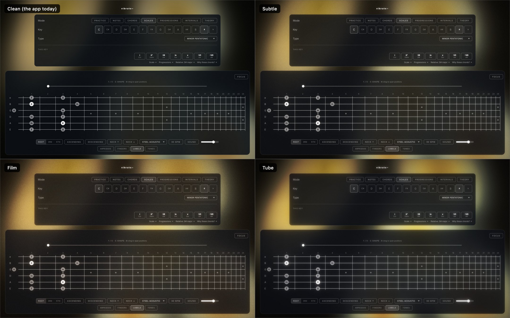
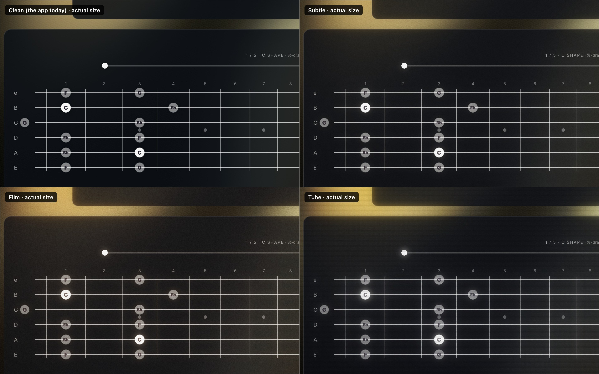
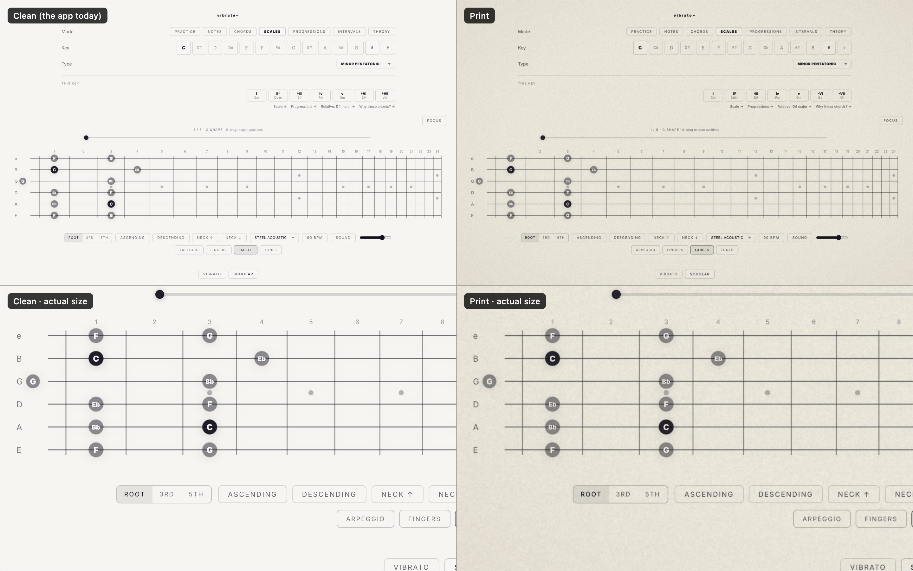

# vibrato~ roadmap

**Working branch:** `vibrato-next` (cut from `codex/practice-sessions` at `1a91f7c`)
**Last updated:** 2026-11-11

This file is the plan of record. It came out of a full review of the app on 2026-11-10 (teaching, layout, look) that the owner approved. It is written so that anyone, human or AI, can pick up a work package without having seen that conversation.

## Status

| # | Work package | Status | Depends on | Who should do it |
|---|---|---|---|---|
| A | Single-screen layout | Next, once B and F have landed (A moves files they edit) | B, F | the strongest model, or an experienced front-end developer: it needs design judgment |
| B | Teaching fixes (five small ones) | **In progress**, handed off 2026-11-11 | nothing | any capable model: fully specified and test-backed |
| C | Chord shapes and small triads | Ready | nothing | a strong model, and a guitarist should check the fingerings |
| D | Discover mode | Ready after A | A (needs the new frame) | a capable model: the content is written and the behaviour is specified |
| E | Practice that adapts, jam loop | Ready after A | A | a capable model |
| F | Look: analog texture | Treatment chosen. **In progress**: making it the default, handed off 2026-11-11 | nothing | any capable model: the values are decided |
| G | Later: hands-free, listening, tunings | Not started | A | to be decided |

The owner's usage is limited, so the rule is: well-specified packages go to cheaper models, and the strongest model keeps the work that needs judgment (A, and reviewing what comes back).

## How to work on this

- Work on `vibrato-next`. Pushes to it run the **Build Vibrato** workflow (lint, tests, Mac package).
- One checkbox per commit where you can. Keep commits small enough to revert.
- In the same commit: tick the box here, and add a dated line to the [log](#log) if you decided anything.
- Before calling something done: `npm test`, `npm run lint`, and the [no-scroll check](#no-scroll-check) if you touched layout.
- Do not change the look (colours, type, shapes, spacing style) outside package F. The owner wants to see mock-ups first.

```sh
npm install
npm run dev        # http://localhost:5173
npm test
npm run lint
npm run app:build  # Mac app in release/
```

## What the app is for

In the owner's words: "getting comfortable on the guitar, practice, training and discovery", "partially just eye candy, and a visual reference for me", and "I like to noodle and improvise, so anything that can inspire me and get my creative juices flowing".

So the measure of any feature is whether it helps someone with a guitar in their hands. That person is looking at the screen from playing distance and cannot easily reach the mouse.

## What is already strong (do not break it)

- **The interval-first path** in Intervals mode (Learn, Shapes, Find, Identify, Shells, Build, Changes), with one colour and shape per interval (`INTERVAL_COLORS`, shapes in `src/lib/music/chordTones.ts`). This colour and shape language is the app's teaching vocabulary. Reuse it everywhere; never invent a second one.
- **The "This key" panel** (`KeyContext`) and the lava background coloured by key (`src/lib/keyPalette.ts`).
- Sampled guitars, CAGED labels that are correct in every key, and key-aware note spelling on the fretboard.

---

## A. Single-screen layout

**Why.** The owner: "the current app has me scrolling the page more than I'd like". Measured in the browser at 1440×900, the size the Electron window opens at (`electron/main.cjs`):

| Mode | Page height | Overflow | What is below the fold |
|---|---|---|---|
| Notes | 900 | 0 | nothing |
| Scales | 1001–1025 | 101–125 | display toggles |
| Intervals | 983–1055 | 83–155 | bottom of the neck in some drills |
| Practice, landing | 1006 | 106 | the end of the page |
| Practice, running | 1247–1359 | 347–459 | ratings, metronome, sound; in the Changes block the lowest string |
| Chords | 1263 | 363 | every chord diagram |
| Progressions | 1378 | 478 | lowest string, Play, chord diagrams |
| Theory | 2166 | 1266 | the circle of fifths |

At 1280×720 every mode overflows by 280 px or more. At 1728×1080 the fretboard is the same size as at 1440×900.

**Causes.**

1. `SettingsList` (mode, key, mode controls, "This key", topics, About) is stacked above the fretboard. It is 285–447 px tall, and 850 px in Theory.
2. The fretboard has a fixed height: `FRETBOARD_LAYOUT.stringGap` is 36 in `src/lib/fretLayout.ts`, so the SVG is always 240 px tall (264 with region badges).
3. Reading text sits above the instrument. Opening "About" in Progressions pushes the neck down to 982 px.
4. Drill controls change height, so the neck moves up to 72 px when you switch Interval drills.

**Target.** One fixed frame that fills the window. The page itself never scrolls.

| Region | Holds | Rule |
|---|---|---|
| Top strip | wordmark, mode switch, key, tempo and transport, theme | one row, fixed height |
| Neck | the fretboard, position slider, focus | takes all remaining height; string gap grows with the window |
| Deck | the controls of the current mode (scale, chord, progression, drill tabs, sound, display toggles) | fixed height for every mode and drill, so the neck never moves |
| Side panel | "This key", chord diagrams, theory text, practice history | the only region that may scroll; can be closed |

Where today's pieces go:

| Piece | Component | Goes to |
|---|---|---|
| Mode switch | `StudyModeControls` | top strip |
| Key | `KeySelector` | top strip |
| Scale, chord, progression pickers and drill tabs | `StudyModeControls`, `IntervalTrainer` | deck |
| Sound and display toggles | `AudioControls`, `DisplayToggles` | deck |
| "This key" | `KeyContext` | side panel |
| Topics and About | `TheoryNavigator`, `TheoryPanel` | side panel |
| Chord diagrams, progression strip | `ChordPositionStrip`, `ProgressionStrip` | side panel, or deck if they fit in its height |
| Practice timer, block, transport, rating | `PracticeSession` | deck |
| Practice history | `PracticeSession` | side panel |
| Circle of fifths and other theory figures | `TheoryStage` | share the neck region, no page scroll |

Within those rules the details are the implementer's call. Keep the current visual style; this package moves things, it does not restyle them.

**Tasks.**

- [ ] Make the shell a grid that fills `100dvh` with the four regions; `overflow: hidden` on the page.
- [ ] Re-home each `SettingsList` section according to the table above.
- [ ] Make the fretboard scale with the space it is given (string gap roughly 36 to 56 px), keeping labels readable.
- [ ] Give the deck one height for all modes and drills.
- [ ] Practice: everything needed during a block is visible at once (neck, timer, transport, rating).
- [ ] Below about 1100 px wide or 680 px tall the side panel becomes a drawer over the neck, not a stacked block.
- [ ] No text under 12 px in anything that gets moved. About two-thirds of the font sizes in the app are below that today (most common: `0.62rem`).
- [ ] Give the three hidden gestures a visible control or a hint while re-homing them: Cmd-drag on the position slider, Cmd-click on Labels, and clicking Vibrato a second time to flip the canvas.

**Done when.**

- At 1440×900, 1280×720 and 960×640 (the Electron minimum), in all seven modes, every Interval drill and every Practice block, the page does not scroll.
- The top edge of the fretboard is at the same y in every mode and drill (within 1 px).
- The fretboard is taller at 1728×1080 than at 1440×900.
- Tests and lint pass.

### No-scroll check

Paste in the dev-tools console for each mode and window size. `page` must equal `window`.

```js
({ page: document.documentElement.scrollHeight, window: innerHeight,
   neckTop: Math.round(document.querySelector('.fretboardStage').getBoundingClientRect().top) })
```

---

## B. Teaching fixes

Five places where the picture contradicts the lesson. Each is small and independent.

- [ ] **Changes drill shows guide tones that jump around.** `changesPositions` in `src/components/IntervalTrainer.tsx` picks each chord's 3rd and 7th relative to that chord's own root. In C, for ii–V–I, it shows Dm7 as F (high-e string, fret 13) and C (B string, 13), then G7 as B (high-e, 7) and F (B, 6), then Cmaj7 as E and B both on the high-e string, while the caption says "Common tone held". The lesson of this drill is the opposite: the guide tones barely move.
  **Fix:** choose positions by the smallest movement from the previous chord, on one pair of adjacent strings.
  **Done when:** in C the drill shows Dm7 as D string 10 (C) and G string 10 (F); G7 as D string 9 (B) and G string 10 (F); Cmaj7 as D string 9 (B) and G string 9 (E). A test asserts no voice moves more than 2 frets between chords, and that "held" is only said when string and fret are unchanged.
- [ ] **Key panel spells flats as sharps.** `src/components/KeyContext.tsx` uses `formatNoteDisplay(note, notation)`, a global sharp/flat switch. In C minor it shows "♭III D#", "♭VI G#", "♭VII A#" and "Relative: D# major", while the fretboard correctly shows E♭.
  **Fix:** use the key-aware spelling in `src/lib/music/noteSpelling.ts`.
  **Done when:** C minor shows E♭, A♭, B♭ and "Relative: E♭ major"; a test covers one sharp key and one flat key.
- [ ] **Shapes drill lists shapes nobody can play.** `getIntervalDyadShapes` in `src/lib/music/intervalShapes.ts` has no reach limit and offers, for example, "String skip −6 frets" for a major 3rd.
  **Fix:** drop shapes that span more than 4 frets.
- [ ] **The active CAGED letter under the neck is invisible.** `.regionBadgeActive` in `src/components/Fretboard.module.css` uses `fill: var(--note-label-fill)`, which is dark on the dark theme and near-white on the light ones.
  **Fix:** use the theme's main text colour. Contrast at least 4.5:1 in Vibrato dark, Vibrato light and Scholar.
- [ ] **Hover looks more "on" than selected.** In `src/styles/glass.module.css`, `.pill:hover` uses `--glass-bg-hover` (0.14 alpha) and `.pillSelected` uses `--glass-bg` (0.06).
  **Fix:** selected is always the strongest state.

---

## C. Chord shapes and small triads

**Why.** Chords mode only knows the E-shape and A-shape barre chords plus open chords, repeated an octave up (`CHORD_SHAPES` in `src/lib/music/positions.ts`; the loop adds 12 to the base fret). C major's five "positions" are open, 3, 8, 15 and 20. Theory mode teaches all five CAGED shapes, so the two modes disagree.

- [ ] Add the C, G and D shapes for the main qualities.
  **Done when:** C major shows five positions inside frets 0–13: C shape (open), A shape (3), G shape (5), E shape (8), D shape (10), each labelled with its letter.
- [ ] Add triads on three adjacent strings: four string sets, three inversions, for major, minor, diminished and augmented. These are what an improviser actually uses.

---

## D. Discover mode

**Why.** The owner asked for "a 'discovery' section where I can hear weird chord progressions, unique scales, different ways to think about notes". The gap today: the app shows where notes are but never puts harmony under them, and a mode only sounds like itself against a chord.

**The one new ingredient is a sustained sound.** `GuitarAudioEngine` (`src/lib/audio/engine.ts`) plays samples and patterns (`playPattern`) but has no drone. Add a pad voice with Tone (slow attack, chorus, low-pass) into the existing reverb and limiter.

Four parts:

| Part | What the player does | What the app does |
|---|---|---|
| **Sounds** | picks an unusual scale | shows it on the neck with interval labels, holds a drone under it, says which note to listen for |
| **Moves** | picks a chord progression | loops it with the pad, lights up the current chord's tones in one position, says what to play over it |
| **Lenses** | picks a way of thinking | for example a brightness dial from Lydian down to Locrian, one flattened note per step |
| **Spark** | asks for a prompt | deals one constraint, such as "Leave two full beats of silence after every phrase." |

**Content is written.** [discover-starter-content.json](discover-starter-content.json) has 12 sounds, 12 moves, 6 lenses and 18 sparks. All numbers are semitones above the key root.

- `sounds[]`: `name`, `tag` (short label), `f` (formula as degree names), `iv` (intervals), `pad` (drone chord), `vibe`, `ear` (what to listen for), `over` (where it fits), `heard` (a recording that uses it).
- `moves[]`: `name` (Roman numerals), `tag`, `ch[]` (each chord: `n` numeral, `o` root offset, `q` quality; map `q` to `ChordQuality` in `src/lib/music/chords.ts`), `vibe`, `why` (why it works), `over` (what to play), `heard`.
- `lenses[]`: `name`, `blurb`, `prompt`, and either `variants[]` (each with `label`, `iv`, `pad`, `note`, optional `lb` label overrides) or `deal: true` (the app deals random notes).
- `sparks[]`: plain sentences.

**Already in the code:** the Build drill draws any interval set (`getPositionsForIntervals`), and `playPattern` loops with count-in and metronome.

- [ ] Pad voice in the audio engine, with drone on/off and its own volume. It stops when you leave the mode.
- [ ] Move the content into typed data under `src/lib/music/` with a test (formula agrees with intervals; numeral agrees with offset).
- [ ] Sounds: neck + drone + "play the scale" + the four lines of text.
- [ ] Moves: loop at the global tempo, one bar per chord; current chord's tones highlighted without the position window jumping.
- [ ] Lenses, starting with the brightness dial (highlight the one note that changed).
- [ ] Spark.
- [ ] Left/right arrows step through entries; Space plays and stops.

**Done when:** it fits the single-screen frame, sound starts with one click, and every entry plays in all twelve keys with correct spelling.

---

## E. Practice that adapts, and a jam loop

**Today.** The session is the same four blocks every day (Roots 2 min, Scale 3, Ear 2, Changes 3), always minor, always the lowest pentatonic box, always the same three ear intervals and i–iv–V. Ratings are saved and never used. See `src/components/PracticeSession.tsx` and `src/lib/practice/`.

- [ ] Rotate the scale box (1 to 5) and the ear intervals from day to day.
- [ ] Use the ratings: a block marked hard comes back tomorrow, one marked easy moves on.
- [ ] Changes block: keep one position window for all three chords.
- [ ] Jam loop: any progression, any tempo, chord tones highlighted in one position. Shares the pad voice from package D.

Research on musicians is small but points toward mixing material within a session over repeating one block (Carter and Grahn, 2016).

---

## F. Look: analog texture

**Chosen by the owner on 2026-11-11: Subtle on Vibrato, Print on Scholar.** Any change to the look beyond those two treatments still needs the owner's sign-off.

**Direction, in the owner's words (2026-11-11):** "there's a minimalist futurism that I'm really into"; the Scholar theme (dark grey on off-white) is the reference. The 80s feeling should come from the medium, not from 80s objects: "televisions, tube amps and the way that screens looked", "film grain", "additional layers of noise that helps diffuse the cleanliness". And: "I don't want to fight the technology we have now", so "a filter of some kind ... to give it an analog look while keeping the minimalism".

**Working rules.**

- Keep the minimal language: thin type, hairlines, lots of space.
- Texture goes on the light, not on the information. Note labels and fret numbers stay sharp.
- Each theme gets the medium it honestly resembles. Vibrato is emitted light (glass, phosphor, film): glow that bleeds, grain that moves. Scholar is ink on paper: fixed paper tooth, slight ink spread, warm stock.
- It should be something you miss when it is switched off, not something you notice when it is on. No cartoon scanlines, no screen curvature, no VHS glitches.
- In the end the user gets one control for the amount. Honour reduced motion.

**Rejected, do not revive:** a "studio rack" concept with chamfered panels, LEDs, dot-matrix readouts and extended-sans legends. The owner's verdict: "generic 80s".

- [x] Mock-ups for the owner: the analog lab and the three images below.
- [x] Owner picks a treatment for each theme. Decided after trying the lab in the installed app: "Subtle is really nice", "print looks great on Scholar".
- [ ] Make that the default look: on for everyone, chosen by theme, with one Texture on/off setting in the theme dock. Keep the lab panel as a hidden tuning tool.
- [ ] Measure what it costs on real hardware (see limits below).

**The chosen values** (0 to 100, as in `PRESETS` in `src/lab/AnalogLab.tsx`):

| Theme | Preset | grain | glow | fade | warmth | vignette | raster | motion |
|---|---|---|---|---|---|---|---|---|
| Vibrato, dark and light canvas | Subtle | 26 | 30 | 8 | 30 | 20 | 0 | 50 |
| Scholar | Print | 60 | 36 | 10 | 50 | 14 | 0 | 0 |

**Parked at the owner's request** ("make a note of it in case I want to bring it up again"): a blend of Subtle and Tube. Subtle as the base, a little of Tube's raster and falloff, and Glow kept low, because Tube's glow washes out the note letters ("lower the glow a little bit for some legibility"). Also "a subtle softness from a tube": a slight overall softening, which the lab has no dial for yet.

### The analog lab (a prototype inside the app, off by default)

A filter is best judged on the real app, and over a few practice sessions, not in a picture. So the mock-up is a switch in the app itself.

- **Open it:** press the backquote key (`` ` ``), or load `http://localhost:5173/?lab=analog`. Hold **B** to see the app without the treatment.
- **Until it is opened it does nothing.** The app renders exactly as before, with no extra elements on the page.
- **Controls:** four presets (Subtle, Film, Tube, Print) and seven dials. The dials change meaning with the theme: Glow becomes Ink spread on Scholar, Grain becomes Paper tooth. **Copy** gives the current settings as one line of text.
- **Code:** `src/lab/AnalogLab.tsx` and `src/lab/AnalogLab.css`, mounted by one line in `src/main.tsx`. Deleting those removes it.

Vibrato, whole window: clean, Subtle, Film, Tube.



The same four at actual size (view at 50% on a Retina display).



Scholar: clean and Print.



**How it is built.**

| Layer | Vibrato dark: emitted light | Scholar and Vibrato light: ink on paper | Mechanism |
|---|---|---|---|
| Glow | bright things bleed warm light across panel edges | ink spreads a little into the paper | one SVG filter on the root element |
| Grain | moves, 8 to 24 steps a second | fixed paper tooth | one 256 px noise tile blended over the window |
| Black lift, warmth, falloff | milky blacks, warm highlights, darker corners | faded ink, cream stock, toned edges | full-window layers with blend modes |
| Raster | faint scanlines and colour stripes | halftone dots | repeating gradients |

**Known limits.**

- The glow filter redraws the whole window. Its real cost (GPU, battery, older Macs) has not been measured. A hidden test window held 120 frames a second with it on, which only shows the main thread is not blocked. The panel shows a live frame rate.
- At high Glow (the Tube preset) the letter on the white root dots washes out. Keep Glow near 50 or below, or exempt the dots.
- Grain honours "reduce motion" and never moves on Scholar.
- Not part of the lab: Scholar's page is already 2 px taller than a 900 px window (902).

---

## G. Later

- **Hands-free control.** Space, arrows and page keys everywhere, so a foot pedal can drive the app.
- **Listening.** A tuner and "play the root, I'll hear it" through the microphone. The `pitchy` library does pitch detection. The Mac build needs a microphone-permission entry.
- **Tunings and capo.**

---

## Log

- **2026-11-10.** Owner asked for a full review: teaching, look and feel, new features.
- **2026-11-11.** Owner approved the review's plan and chose the single-screen layout as the first piece of work. Rejected the first concept's styling as "generic 80s". Set the look direction: minimalist futurism plus analog texture, mock-ups before any change.
- **2026-11-11.** Branch `vibrato-next` created. This roadmap and the Discover starter content added.
- **2026-11-11.** Analog lab prototype added for package F, off by default, with comparison images. Full-frame glow uses a filter on the root element because a blurred overlay cannot be screen-blended in Chromium (the blur replaces the page instead of adding to it).
- **2026-11-11.** Owner chose the look: Subtle on Vibrato, Print on Scholar. A Subtle and Tube blend is parked. "Hidden gestures" moved from package B to package A, because A re-homes those controls. Packages B and F were handed to separate sessions on a cheaper model; A follows when they land.
