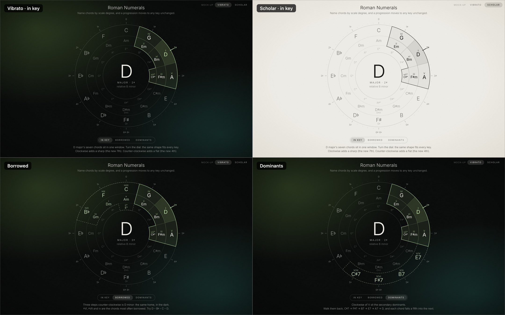

# Key dial (design mock-up)

**Status:** proposal, waiting for the owner's review (2026-11-11). Nothing in the app has changed yet.

One dial to replace both figures in Theory › Roman Numerals: the Circle of Fifths (`src/components/CircleOfFifths.tsx`) and the Chord Wheel (`src/components/ChordWheel.tsx`). The owner asked for an overhaul of both and said the circle of fifths "is closer to what I'm looking for".



## Open it

The page loads Inter from `node_modules`, so run `npm install` first. Safari shows the real font; other browsers may fall back to the system font.

```bash
open "docs/design/key-wheel/index.html"
```

- Click a major to choose that major key, or a minor for that minor key. Click F♯ again for G♭.
- The arrow keys turn the dial.
- URL options: `?theme=scholar&key=Gb&mode=minor&view=borrowed` (`b` for flat, `s` for sharp).

## What it teaches

- **One window, every key.** IV, I and V sit side by side on the outer ring, their relative minors ii, vi and iii directly inside, and vii° under V. The shape never changes, so turning the dial is transposing.
- **Key signatures live on the bezel.** Clockwise adds a sharp (the new key's 7th); counter-clockwise adds a flat (its 4th). This replaces the old arrows and annotations.
- **Borrowed.** The parallel minor is the same window three steps counter-clockwise: ♭VI, ♭III and ♭VII outside, iv, i and v inside, ii° below. For a minor key, the parallel major is three steps clockwise.
- **Dominants.** The four keys clockwise of V are the secondary dominants (V/V, V/ii, V/vi, V/iii). Walked back counter-clockwise, each falls a fifth into the next.

## Design rules

- Hairlines and Inter 300/400 only. The key colour is the single accent in Vibrato; Scholar is ink only.
- Labels stay upright; only the window turns, the short way round, in about half a second (instantly with reduced motion).
- No text below 12 px at the size the dial is shown. Sizes are in `RINGS` and `SMALL` in `key-wheel.js`, in units of a 1000 × 1000 view box.
- Chords are spelled in the selected key: C♭ in G♭ major, E♯° in F♯ major. A parallel key that would need double accidentals is respelled (D♭ minor is written C♯ minor), and the caption follows that spelling.

## Building it into the app (after the owner approves)

1. Move the music logic in `key-wheel.js` (`scale`, `simplest`, `windowCells`, `describe`) into `src/lib/music/keyDial.ts`, reconciled with `noteSpelling.ts`. Test it in all twelve keys and both modes: the seven chords and numerals, the borrowed window, the dominants, and the spelling cases above.
2. Make one `KeyDial` component with the props the old figures take (`selectedRoot`, `keyMode`, `onSelectKey`), so `TheoryStage.tsx` can swap it in. The "Circle of Fifths / Chord Wheel" toggle becomes "In key / Borrowed / Dominants".
3. Take the accent from the app's key colours (`src/lib/keyPalette.ts`), not the mock-up's hue formula.
4. Clicking a chord plays it, as elsewhere in the app.
5. Size the dial to the space the single-screen layout (roadmap package A) gives Theory figures. The page must not scroll.
6. Remove `CircleOfFifths`, `ChordWheel` and their CSS, and `circleOfFifths.ts` / `chordWheel.ts` if nothing else uses them.
